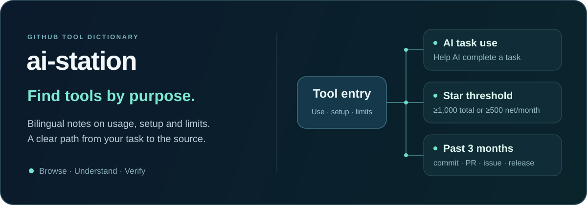

<p align="center">
  
</p>

<a id="ai-station"></a>

<h1 align="center">ai-station</h1>

<p align="center">A bilingual GitHub tool catalog. Find a purpose, check the fit.</p>

<p align="center">
  <a href="#included"></a>
  <a href="#candidates"></a>
  <a href="#categories"></a>
  
</p>

<p align="center"><a href="README.md">简体中文</a> · <strong>English</strong></p>

<p align="center"><a href="#featured">Featured</a> · <a href="#categories">Categories</a> · <a href="#criteria">Criteria</a> · <a href="reviews/2026-11-16-wechat.md">Review record</a></p>

<p align="center">
  
</p>

The catalog contains 249 projects: **220 included** and **29 candidates**, across nine categories. Each project has one bilingual page covering its purpose, features, requirements, limitations, getting started and review evidence.

Use it to find tools for a task, compare setup requirements or explore code worth learning from. Read the catalog in your browser, then follow the selected project's own setup guide.

<a id="start"></a>

## Find a tool

1. **Start with a task.** Try the [featured entries](#featured) or choose one of the [nine categories](#categories).
2. **Narrow the list.** Expand a category and use Ctrl/⌘+F for a name or purpose. GitHub repository search also covers the individual pages in `docs/`.
3. **Check the fit.** Open the entry, read its environment and license limits, check the review date, then continue to the upstream documentation.

<p align="center">
  
</p>

<a id="featured"></a>

## Featured starting points

Six entries for common tasks. Selection reflects documented use cases; it is not a ranking or a claim of hands-on testing.

| What you want to do | Entry | Check before using |
| --- | --- | --- |
| Find models that fit your machine | [llmfit](docs/llmfit.md#english) | Estimates RAM and VRAM fit; estimates are not measured speed. |
| Diagram your technology stack | [Stack Diagram](docs/stack-diagram.md#english) | Exports SVG, HTML or PNG; PNG needs browser dependencies. |
| Create videos with web technology | [Hyperframes](docs/hyperframes.md#english) | Renders HTML/CSS animation to MP4; needs Node.js, FFmpeg and Chromium. |
| Organize research notes and long-form writing | [Zettlr](docs/zettlr.md#english) | Markdown, citations and exports; configure bibliography and export tools. |
| Monitor hosts and services | [Netdata Agent](docs/netdata.md#english) | Covers the open-source Agent core; the Web UI and Cloud have separate licenses. |
| Connect mobile devices to agents | [Mobile MCP](docs/mobile-mcp.md#english) | Controls Android/iOS apps; needs an MCP client and platform device tools. |

<a id="criteria"></a>

## Inclusion criteria

- **Concrete value.** Review the use case, functional implementation, documentation and entry point. Stars are recorded without a minimum; low-Star projects need a specific quality rationale. Experiments are labeled with their limits.
- **Substantive recent activity.** Require a confirmed feature, bug fix, substantive merged change or official release within the previous **three calendar months**. A release must identify a concrete feature or fix; its date and stable-release flag alone are insufficient. Documentation-only, mechanical bot updates and `pushed_at` alone do not qualify. An initial functional implementation can qualify without proving sustained maintenance.
- **Clear license and scope.** The repository must be public, neither archived nor disabled, with reviewed open-source license text. Mixed-license entries cover only the identified open components. Record software-license approval separately from the terms for weights, datasets, media and paid services.
- **Traceable review.** Review both languages and record dated sources, license and activity evidence. Pin license evidence to a commit SHA and record its file hash; getting-started links may point to current documentation. Repository snapshots must be no more than seven days old at review time. Recheck stale records before relying on them.

These criteria took effect on 2026-11-16. Inclusion records a review decision; it does not establish performance, compatibility or security through runtime testing. Keep current candidate decisions separate from historical assessments, with reasons and pending actions. Removing the Star threshold does not automatically promote a candidate.

<a id="categories"></a>

## Browse by category

Choose a category, then expand its list. Counts include both older entries and this review's additions.

| Category | Find | Included | Candidates |
| --- | --- | ---: | ---: |
| [AI tools](#included-ai) | Models, agents, memory and knowledge bases | [55](#included-ai) | [3](#candidate-ai) |
| [Development](#included-development) | Coding, review, interfaces and engineering | [63](#included-development) | [4](#candidate-development) |
| [Images, audio and video](#included-media) | Images, animation, audio and video creation | [39](#included-media) | [8](#candidate-media) |
| [Documents and productivity](#included-productivity) | Writing, notes, office and everyday tools | [27](#included-productivity) | [10](#candidate-productivity) |
| [Automation](#included-automation) | Scheduling, devices and application control | [11](#included-automation) | [1](#candidate-automation) |
| [Deployment and operations](#included-operations) | Deployment, monitoring, systems and services | [11](#included-operations) | [1](#candidate-operations) |
| [Data processing](#included-data) | Data queries, research and analysis | [8](#included-data) | [2](#candidate-data) |
| [Terminal and shell](#included-terminal) | Terminals and command-line tools | [3](#included-terminal) | 0 |
| [Knowledge and learning](#included-knowledge) | Textbooks, atlases and interactive learning | [3](#included-knowledge) | 0 |

<a id="included"></a>

## Included (220)

Open a name for its bilingual entry and dated evidence. Stars below are review-time snapshots, not a live ranking.

<a id="included-ai"></a>

<details>
<summary><strong>AI tools</strong> · 55 projects</summary>

| Project | Purpose | Category | Stars |
| --- | --- | --- | ---: |
| [Agency Agents](docs/agency-agents.md#english) | Provides AI-agent instructions, workflows and deliverable templates organized by professional role. | AI tools | 168864 |
| [Agent Beacon](docs/agent-beacon.md#english) | Collects coding-agent session traces and makes reviewed working knowledge reusable by later agents. | AI tools | 3543 |
| [Agent Reach](docs/agent-reach.md#english) | Gives agents search and reading tools across websites, video platforms, forums and several Chinese services. | AI tools | 112225 |
| [ai-memory](docs/ai-memory.md#english) | Shared project memory for coding assistants, with searchable notes, session handoffs and optional document import and summaries. | AI tools | 15919 |
| [AirLLM](docs/airllm.md#english) | Reduce LLM VRAM demand by loading and offloading weights layer by layer, with streamed LoRA training interfaces for selected models. | AI tools | 42524 |
| [AstrBot](docs/astrbot.md#english) | Connect LLM conversations and agents to messaging platforms, with plugins, knowledge bases and a web administration interface. | AI tools | 47065 |
| [Claude-Mem](docs/claude-mem.md#english) | Records coding-agent observations and retrieves relevant memory in later sessions. | AI tools | 117552 |
| [Codex ChatGPT Web Bridge](docs/codex-chatgpt-web.md#english) | Provides a third-party bridge from a signed-in local ChatGPT Web session to Codex. | AI tools | 15746 |
| [colibri](docs/colibri.md#english) | Runs local models with C inference engines that load weights from RAM and disk on demand, with optional GPU acceleration. | AI tools | 51605 |
| [DeepInfer](docs/deepinfer.md#english) | An inference implementation for DeepSeek models with optimized compute and distributed execution components. | AI tools | 26102 |
| [DeepSeek chat-demo](docs/deepseek-chat-demo.md#english) | A static chat interface for the DeepSeek API, with streaming replies, conversation branches, attachments and history import/export. | AI tools | 3890 |
| [DeepTutor](docs/deeptutor.md#english) | Combines learning materials, tutoring conversations, practice and study records in an AI learning workspace. | AI tools | 59827 |
| [DSH Desktop](docs/dsh-desktop.md#english) | A DeepSeek Harness desktop workspace for models, Office templates, skills and plugins, supporting document, spreadsheet and presentation workflows. | AI tools | 19341 |
| [dsh-superagent 研究原型](docs/dsh-superagent-prototype.md#english) | Research code for an agent that monitors one GitHub repository and optionally Feishu, then works on authorized tasks. | AI tools | 23202 |
| [FreeLLM API](docs/freellmapi.md#english) | Combines the user's own model-provider accounts behind a local gateway with OpenAI-compatible endpoints, routing, failover and quota tracking. | AI tools | 53227 |
| [FreeToken](docs/freetoken.md#english) | A local mixture-of-experts inference engine that combines GPU, CPU and system memory with expert caching and serving APIs. | AI tools | 17244 |
| [Gemini CLI](docs/gemini-cli.md#english) | A terminal AI agent maintained for enterprise Gemini Code Assist workflows, with code inspection, file editing and tool execution. | AI tools | 108884 |
| [Geo Sleuth](docs/geo-sleuth.md#english) | Provides an agent workflow for locating photos from terrain, skylines, roads and map searches, returning candidate locations, viewing directions and evidence. | AI tools | 7109 |
| [Heretic](docs/heretic.md#english) | A tool for studying language-model style, refusal and sycophancy through training-free parameter modification. | AI tools | 40743 |
| [Hindsight](docs/hindsight.md#english) | Stores facts and experiences for agents and retrieves or synthesizes relevant memory. | AI tools | 61351 |
| [Jev Chat Jarvis](docs/jev-chat-jarvis.md#english) | An Android chat-assistance overlay that uses accessibility and OCR to read current conversation context, analyze it and draft replies for user-selected insertion. | AI tools | 8409 |
| [Laya](docs/laya.md#english) | A non-autoregressive decision engine for classification, choice selection, scoring and routing, producing structured outputs and confidence information. | AI tools | 35592 |
| [Laya-MLX](docs/laya-mlx.md#english) | Runs structured selection, scoring and boolean decisions through MLX on Apple Silicon. | AI tools | 7107 |
| [llama.cpp](docs/llama-cpp.md#english) | A ggml-based C/C++ inference engine with local command-line tools, serving interfaces and multimodal model support. | AI tools | 135378 |
| [llmfit](docs/llmfit.md#english) | Detects CPU, RAM and GPU memory to estimate local model and quantization fit, exposing TUI, web, CLI/API and benchmarking interfaces. | AI tools | 39014 |
| [Magpie](docs/magpie.md#english) | A local gateway that routes coding-agent requests across configured model providers and accounts, with optional failover and masking. | AI tools | 36740 |
| [MiniMind](docs/minimind.md#english) | Teaches language-model implementation from pretraining and fine-tuning to inference serving using small models. | AI tools | 65498 |
| [Octop](docs/octop.md#english) | A self-hosted multi-user, multi-agent assistant with expert libraries, web/CLI/messaging access, scheduled tasks, knowledge bases and MCP/ACP interfaces. | AI tools | 12113 |
| [Ollama](docs/ollama.md#english) | Download, manage and run language models, exposing model access to applications and agents through a CLI and local API. | AI tools | 187285 |
| [oMLX](docs/omlx.md#english) | A local model-serving system with menu-bar management for Apple-silicon Macs. | AI tools | 23663 |
| [Open Interpreter](docs/open-interpreter.md#english) | The current mainline is a Rust terminal coding agent with model-provider integration, tool use, MCP/ACP, skills and native sandboxing. | AI tools | 68895 |
| [OpenBot application template](docs/copilotkit-openbot.md#english) | An open-source application template for AI coworker workspaces connecting models, AG-UI agents and MCP tools; operation requires separately licensed CopilotKit Intelligence. | AI tools | 12624 |
| [OpenCode](docs/opencode.md#english) | Uses models in terminal or desktop interfaces to explore, plan and modify code. | AI tools | 227359 |
| [OpenDots](docs/opendots.md#english) | A community starter for persistent AI coworkers, with web, mobile and messaging interactions and per-agent computer workspaces. | AI tools | 6624 |
| [OpenFuse（原OpenMuse）](docs/openfuse.md#english) | Provides a personal-agent application template with a browser, terminal and file workspace. | AI tools | 6496 |
| [OpenHands](docs/openhands.md#english) | An agent workspace for software development with conversations, tool execution and change review. | AI tools | 93582 |
| [OpenMAIC](docs/openmaic.md#english) | Turns topics or documents into interactive classrooms with AI teachers and classmates. | AI tools | 43722 |
| [OpenMausBot](docs/openmausbot.md#english) | A desktop chat interface for coordinating agents with separate models, workspaces and connected applications. | AI tools | 23982 |
| [OpenViking](docs/openviking.md#english) | Organizes agent knowledge, memory and skills in a browsable virtual filesystem. | AI tools | 42305 |
| [Paperclip](docs/paperclip.md#english) | Coordinates AI teams through organizations, goals, tasks, permissions and budgets, connecting existing agents and tracking execution and model costs. | AI tools | 114265 |
| [PilotDeck](docs/pilotdeck.md#english) | Organizes agent tasks, memory, skills and long-running work around separate workspaces. | AI tools | 4998 |
| [Prime Agent](docs/prime-agent.md#english) | Executes coding and research tasks through a persistent Python environment, subagents and background sessions. | AI tools | 22746 |
| [Qwen Code](docs/qwen-code.md#english) | An AI coding agent for terminals, editors and desktops that explores repositories, edits code and invokes development tools. | AI tools | 30668 |
| [Rakazo](docs/rakazo.md#english) | A self-hostable AI team workspace with persistent memory, routines and agent computers. | AI tools | 8776 |
| [Ruflo](docs/ruflo.md#english) | Provides task orchestration, shared memory and MCP tool integration for coding agents. | AI tools | 81892 |
| [StarNet](docs/starnet.md#english) | A desktop workspace that represents working agents as a pixel-art space station. | AI tools | 1854 |
| [Suparagent](docs/suparagent.md#english) | A workspace for named agents with conversations, workspaces, memory, routines and approval controls. | AI tools | 7087 |
| [SuperMimic](docs/supermimic.md#english) | A humanoid motion-tracking research implementation that trains whole-body control with a differentiable world model. | AI tools | 1646 |
| [TimesFM（开源代码与 ≤2.5 权重）](docs/timesfm.md#english) | Google Research's time-series forecasting codebase provides pretrained-model inference, quantile forecasts and covariate support. This entry covers Apache-2.0 source code and open weights through version 2.5. | AI tools | 35602 |
| [Transformers](docs/transformers.md#english) | A Python framework for loading, training and running text, vision, audio and multimodal models. | AI tools | 169089 |
| [Unsloth](docs/unsloth.md#english) | Tools for running and fine-tuning language, diffusion, speech and embedding models, including local desktop/Studio workflows. | AI tools | 79601 |
| [uzu](docs/uzu.md#english) | A Rust engine with language bindings for embedding model downloads, chat sessions and local inference in applications. | AI tools | 3358 |
| [vLLM](docs/vllm.md#english) | An inference and serving framework for language and multimodal models, with request batching, distributed inference and APIs compatible with common clients. | AI tools | 97064 |
| [WeKnora](docs/weknora.md#english) | An enterprise-document knowledge base and RAG service combining parsing, retrieval, agents and wiki workflows. | AI tools | 37540 |
| [XERJ](docs/xerj.md#english) | An open-source search engine for AI agents, indexing code, documents and logs for full-text, vector and hybrid retrieval. | AI tools | 19162 |

</details>

<a id="included-development"></a>

<details>
<summary><strong>Development</strong> · 63 projects</summary>

| Project | Purpose | Category | Stars |
| --- | --- | --- | ---: |
| [2010 Rust Rewrite Mashup](docs/2010-rust-rewrite-mashup.md#english) | A Rust game-mashup experiment combining MW2-style environments, skating and voxel maps for studying game reimplementation and asset compatibility. | Development | 951 |
| [agent-browser](docs/agent-browser.md#english) | Provides web snapshots, element actions and browser-session commands for AI agents. | Development | 52076 |
| [AI Infra Book](docs/ai-infra-book.md#english) | An AI infrastructure textbook and calculation toolkit covering hardware, model architecture, inference and training, with web, PDF/EPUB and capacity-planning scripts. | Development | 7897 |
| [AI Website Cloner Template：网站复刻与迁移模板](docs/ai-website-cloner-template.md#english) | A Next.js template and agent workflow for observing existing webpages and rebuilding their layout, assets and interactions as editable code. | Development | 39159 |
| [AnyPS5](docs/anyps5.md#english) | A compatibility project for relinking console executables to desktop platforms. | Development | 54377 |
| [Archify](docs/archify.md#english) | Turns ideas, plans and repository material into interactive HTML diagrams and explanatory pages with source references. | Development | 96538 |
| [Claude Code Game Studios](docs/claude-code-game-studios.md#english) | A Claude Code template and skill collection for turning a game idea into a brief, browser prototype and incremental implementation. | Development | 39708 |
| [Claude Community Plugins：目录与校验器](docs/claude-plugins-community.md#english) | Provides a Claude community plugin directory and a reusable marketplace CI validator. | Development | 4903 |
| [Claude Plugins Official](docs/claude-plugins-official.md#english) | Anthropic's plugin directory for extending Claude development and work workflows. | Development | 47430 |
| [Claude Red](docs/claude-red.md#english) | A Claude Code skill collection for authorized security research and CTF work. | Development | 11091 |
| [CLI-Anything](docs/cli-anything.md#english) | A framework for building command-line interfaces that drive real application backends, including JSON output and interactive workflows. | Development | 58741 |
| [code-review-graph](docs/code-review-graph.md#english) | Builds an incremental local code graph for dependency queries, impact exploration and review context. | Development | 32776 |
| [Codex with ChatGPT](docs/codex-with-chatgpt.md#english) | Connects ChatGPT web planning and review to a Codex workspace through a read-only MCP bridge. | Development | 7718 |
| [Cordis](docs/cordis.md#english) | A TypeScript framework for components, service dependencies and lifecycle management. | Development | 9915 |
| [Craft Anything](docs/craft-anything.md#english) | An early application-research and rebuilding workspace that combines inspection, agent-assisted implementation and comparison. | Development | 33239 |
| [ECC](docs/ecc.md#english) | Combines planning, review, memory, context management and engineering checks for coding agents. | Development | 304243 |
| [ego-browser for ego lite](docs/ego-lite.md#english) | An open-source skill and tool layer connecting AI agents to the ego lite browser, with JavaScript page actions and separate task workspaces. | Development | 23215 |
| [Expo Skills](docs/expo-skills.md#english) | Supplies AI coding agents with workflows for Expo development, upgrades, debugging and EAS delivery. | Development | 4177 |
| [Flutter](docs/flutter.md#english) | A Dart UI toolkit for building mobile, web and desktop applications. | Development | 181237 |
| [Garden Skills](docs/garden-skills.md#english) | Reusable skills, scripts and templates for AI coding agents, covering web design, presentations, image creation and local knowledge retrieval. | Development | 15316 |
| [Ghidra](docs/ghidra.md#english) | A reverse-engineering framework for compiled programs with disassembly, decompilation and scripting. | Development | 100277 |
| [Godogen](docs/godogen.md#english) | Uses coding agents to generate standalone game projects and assets for targets including Godot, Bevy, Babylon.js and Three.js, with runtime verification workflows. | Development | 7354 |
| [GPUI Kit](docs/gpui-kit.md#english) | A Rust GPUI desktop component library with tables, editors, layouts, accessibility support and an optional JavaScript host. | Development | 20833 |
| [Graphify](docs/graphify.md#english) | Builds queryable graphs from code and other materials, supporting relationship exploration and visual explanations. | Development | 148039 |
| [Hallmark](docs/hallmark.md#english) | An agent skill for choosing visual styles, building interfaces and checking page design. | Development | 55872 |
| [Henge](docs/henge.md#english) | A JIT emulator for running macOS on iPhone and iPad for compatibility experiments. | Development | 2357 |
| [Impeccable](docs/impeccable.md#english) | Provides frontend design, review and refinement commands for coding agents. | Development | 111148 |
| [islandcn](docs/islandcn.md#english) | A Dynamic Island-style activity component for React, with state management, transitions, animation and reusable presets. | Development | 760 |
| [JADX](docs/jadx.md#english) | A decompiler that turns Android DEX, APK and Java bytecode into readable Java source. | Development | 51846 |
| [LASRecomp](docs/lasrecomp.md#english) | Recompiles the Switch edition of Link's Awakening into native desktop or mobile programs with graphics, input and platform compatibility code. | Development | 2451 |
| [Lightpanda Browser](docs/lightpanda.md#english) | A headless browser for automation and agents, with JavaScript execution, page interaction and HTML, Markdown or structured extraction. | Development | 42129 |
| [MacNativeGames](docs/macnativegames.md#english) | Explores adapting selected games' graphics and system calls to Apple silicon and Metal. | Development | 7913 |
| [Moli：面向 AI 智能体的无头浏览器](docs/moli.md#english) | A Rust headless browser for JavaScript execution, page extraction and browser automation, with optional layout, screenshots and PDF output. | Development | 23783 |
| [nxnative](docs/nxnative.md#english) | Translates user-owned Switch game programs into native Apple applications, with Horizon and graphics compatibility layers for static-recompilation research. | Development | 15844 |
| [Open Code Review](docs/open-code-review.md#english) | Reviews Git diffs or whole files with a configurable model and produces line-level findings. | Development | 52711 |
| [OpenSmash-Ultimate](docs/opensmash-ultimate.md#english) | A static-recompilation project for running a specific, user-supplied Switch game on desktop platforms. | Development | 188 |
| [Orca（智能体开发工作台）](docs/orca.md#english) | A coding-agent workspace with multiple project views, terminals, change review, remote SSH and mobile companions. | Development | 125338 |
| [Plannotator](docs/plannotator.md#english) | Provide a local browser review interface for AI agents, annotating plans, documents, web artifacts and code diffs and returning feedback to the session. | Development | 12679 |
| [Ponytail](docs/ponytail.md#english) | Helps coding agents reuse existing implementation, review changes and record task cost and test status. | Development | 191880 |
| [PR-Agent](docs/pr-agent.md#english) | Use LLMs to analyze pull requests, generate change descriptions and reviews, and answer questions about diffs. | Development | 16305 |
| [REA — Reverse Engineer Anything](docs/rea.md#english) | CLI and MCP tooling for examining binaries, JavaScript, desktop apps and websites with multiple analysis backends. | Development | 460761 |
| [S2Arm](docs/s2arm.md#english) | Translates supported, user-supplied Switch games into ARM64 programs for Apple devices, with graphical packaging and library management. | Development | 3346 |
| [Screenshot to Code](docs/screenshot-to-code.md#english) | Generates and iterates on web-interface code from screenshots, designs or screen recordings. | Development | 81243 |
| [Security Audit Skill](docs/security-audit-skill.md#english) | A source-security audit skill with validators for coverage records and structured findings. | Development | 73608 |
| [Semantica](docs/semantica.md#english) | A library for organizing data into knowledge and context graphs with provenance and reasoning records. | Development | 14627 |
| [Skills For Real Engineers（Matt Pocock）](docs/skills.md#english) | Composable coding-assistant skills for requirements, architecture, implementation, review and refactoring. | Development | 324716 |
| [SkillSpector](docs/skillspector.md#english) | Scans agent skills for suspicious instructions, code behavior and security issues. | Development | 26363 |
| [Spec Kit](docs/spec-kit.md#english) | A toolkit for specification-driven development, connecting requirements, plans, tasks and implementation through agent workflows. | Development | 149841 |
| [Stack Diagram](docs/stack-diagram.md#english) | Turns stack descriptions into architecture diagrams with service icons and connections, exporting SVG, HTML and PNG in light or dark themes for project documentation. | Development | 2537 |
| [Stitch Design Skills](docs/stitch-skills.md#english) | Agent skills for UI design, design-system extraction and frontend implementation through Google Stitch MCP. | Development | 9786 |
| [Superpowers](docs/superpowers.md#english) | Provides coding agents with skills for requirements, planning, testing and code review. | Development | 318748 |
| [T3 Code](docs/t3code.md#english) | Manages coding-agent sessions, diffs and remote connections in one interface, with desktop, web and phone access. | Development | 62317 |
| [Taste Skill](docs/taste-skill.md#english) | Provides website design workflows, asset tools and browser checks for coding agents. | Development | 116605 |
| [Text to CAD](docs/text-to-cad.md#english) | Agent tools for turning design requests into parametric CAD scripts and manufacturing files. | Development | 26417 |
| [ThinkRail](docs/thinkrail.md#english) | Builds workspace, editor, change-review and project-specification tools around the pi coding agent. | Development | 8310 |
| [Univer](docs/univer.md#english) | An embeddable spreadsheet and document SDK with formulas, rendering, editing and programmatic APIs, including headless processing. | Development | 27511 |
| [Universal Modder](docs/universal-modder.md#english) | Combines agent skills, the um CLI and a knowledge base for engine discovery, asset processing and in-game validation during mod development. | Development | 9725 |
| [Unreal Engine Skills for Claude Code](docs/unreal-engine-skills.md#english) | Skills and session hooks that guide Claude Code in operating Unreal Editor through MCP. | Development | 1980 |
| [Vercel Skills CLI](docs/vercel-skills.md#english) | A CLI for discovering, installing and managing AI coding-agent skills at project or global scope. | Development | 39716 |
| [Voxel Musou](docs/voxel-musou.md#english) | A browser Three.js voxel-action game with multiple characters, chapters and trials, useful for studying lightweight gameplay, rendering and local progress management. | Development | 178 |
| [vphone-cli](docs/vphone-cli.md#english) | Runs a virtual iPhone on Apple Silicon Macs for research and debugging. | Development | 16695 |
| [Wakaru](docs/wakaru.md#english) | A JavaScript decompiler that unbundles packages, expands minified code and restores some transpiled structures through a CLI or playground. | Development | 1090 |
| [Worktrunk](docs/worktrunk.md#english) | Simplifies switching, inspecting and removing Git worktrees for parallel coding tasks. | Development | 12565 |

</details>

<a id="included-media"></a>

<details>
<summary><strong>Images, audio and video</strong> · 39 projects</summary>

| Project | Purpose | Category | Stars |
| --- | --- | --- | ---: |
| [15 种动态设计风格](docs/mg-styles-15.md#english) | Fifteen short motion-design examples with style prompts, source code and audio tooling. | Images, audio and video | 3540 |
| [3D Model Anything](docs/3d-model-anything.md#english) | Tools and agent workflows for turning room scans into editable Three.js scenes. | Images, audio and video | 3031 |
| [Abyssal Garden](docs/abyssal-garden.md#english) | An interactive underwater scene packaged as one HTML file, using WebGPU graphics and synthesized audio. | Images, audio and video | 1440 |
| [Anatomy](docs/anatomy.md#english) | Creates interactive isometric explanations of machines, instruments and mechanisms using browser-based graphics. | Images, audio and video | 27394 |
| [Animate 程序化动画](docs/animate.md#english) | Builds procedural Canvas animations with music and timed narration, then renders video using browser tools and FFmpeg. | Images, audio and video | 1967 |
| [Arnis](docs/arnis.md#english) | Converts geographic and elevation data into block-game worlds. | Images, audio and video | 18642 |
| [ArtCraft](docs/artcraft.md#english) | A desktop AI creation workspace combining 2D composition, 3D scenes and image/video models to organize generative media workflows. | Images, audio and video | 41207 |
| [ASCII](docs/ascii.md#english) | A TypeScript ASCII-animation library for React, Next.js, Astro, Web Components and plain HTML, with SVG output. | Images, audio and video | 1232 |
| [Bang Motion](docs/bang-motion.md#english) | Creates openers, promos, product clips and typography as a single HTML animation with optional video export. | Images, audio and video | 2201 |
| [cinecode](docs/cinecode.md#english) | An agent skill for making films with code, using browser scenes, sound design and FFmpeg to produce MP4 files. | Images, audio and video | 2593 |
| [Claude Animated Shorts](docs/claude-animated-shorts.md#english) | A Claude Code skill for vertical animated shorts, with Three.js and Remotion scenes, sound helpers and a bridge-story example. | Images, audio and video | 3658 |
| [Claude Animation Base](docs/claudeanimationbase.md#english) | A p5.js and p5.brush animation starter with drawing primitives, character scenes, timelines and MP4 rendering. | Images, audio and video | 2995 |
| [Deskworlds](docs/deskworlds.md#english) | Runs interactive local 3D scenes on the Mac desktop and in a browser. | Images, audio and video | 468 |
| [Diagram Design](docs/diagram-design.md#english) | An agent skill for producing standalone HTML and SVG diagrams of structures, processes and comparisons. | Images, audio and video | 67558 |
| [GIF 工厂 / GIF Factory](docs/gif-factory.md#english) | A collection of agent skills, examples and scripts for stickers, animated posters, signatures, storybooks and explanatory videos. | Images, audio and video | 1940 |
| [God's Eye View](docs/gods-eye-view.md#english) | An interactive 3D globe combining public transport, geographic and environmental data. | Images, audio and video | 65241 |
| [Handy](docs/handy.md#english) | Shortcut-driven local speech recognition that pastes text into the current field, with model choices including Whisper and Parakeet. | Images, audio and video | 38948 |
| [Hex](docs/hex.md#english) | On-device dictation that pastes into the active application, with vocabulary, history, processing steps and file transcription. | Images, audio and video | 7045 |
| [Holo Card Studio](docs/holo-card-studio.md#english) | Builds layered images into interactive holographic-card pages and editable Blender projects. | Images, audio and video | 2106 |
| [HolyArrs](docs/holyarrs.md#english) | A self-hosted web application for media requests, selection rules, subtitles and library imports, connecting existing downloaders and media servers. | Images, audio and video | 1325 |
| [Huashu Design](docs/huashu-design.md#english) | An agent skill for producing HTML designs, app prototypes, presentations, animations and explanatory graphics. | Images, audio and video | 29538 |
| [Hyperframes](docs/hyperframes.md#english) | Creates videos from HTML/CSS and seekable animations, rendering MP4 with headless Chromium and FFmpeg through a CLI, agent skills or desktop studio. | Images, audio and video | 85034 |
| [Mac Duo](docs/mac-duo.md#english) | Applies tilt, blur and dimming to live desktop content as a MacBook lid moves. | Images, audio and video | 1236 |
| [MCP for Blender](docs/mcp-for-blender.md#english) | Connects agents to Blender through MCP for scenes, models, materials and rendering, with optional asset-service integrations. | Images, audio and video | 34616 |
| [MoneyPrinterTurbo](docs/moneyprinterturbo.md#english) | Turns topics or keywords into scripts, narration, assets and subtitles, then composes short videos. | Images, audio and video | 144052 |
| [MyGo Music](docs/mygo-music.md#english) | A native desktop music player for local files, lyrics and playlists, with plugins for catalogs, podcasts and radio. | Images, audio and video | 1408 |
| [Open Generative AI](docs/open-generative-ai.md#english) | A self-hostable interface for AI image and video creation through MuAPI cloud models, with local inference-engine integrations in the desktop app. | Images, audio and video | 35058 |
| [OpenCreator](docs/opencreator.md#english) | Organizes content creation through conversation and a visual workspace, managing runs, media, subtitles and revisions. | Images, audio and video | 14380 |
| [Subvox](docs/subvox.md#english) | A small-vocabulary prototype testing whether AirPods head-motion data can identify silently mouthed words. | Images, audio and video | 838 |
| [Teardown：交互式机械拆解与3D演示](docs/teardown.md#english) | A Claude Code skill for interactive 3D mechanism explanations, exploded views, sections and recorded video. | Images, audio and video | 3534 |
| [Turbo Kart Rally](docs/turbo-kart-rally.md#english) | A Three.js browser kart racer and example of procedural game content. | Images, audio and video | 50 |
| [Upscayl](docs/upscayl.md#english) | A desktop tool that enlarges low-resolution images with AI super-resolution models, supporting batch processing and model selection. | Images, audio and video | 52784 |
| [VoiceStudio](docs/voicestudio.md#english) | Voice software for cloning, speech design, transcription and dubbing, with batch processing and agent interfaces. | Images, audio and video | 110994 |
| [Whisper](docs/whisper.md#english) | A multilingual speech-recognition model and toolkit for transcription, language detection and speech translation into English. | Images, audio and video | 112864 |
| [YuE2 推理代码 / YuE2 inference code](docs/yue.md#english) | Generates vocals and accompaniment from editable melody and chord plans. | Images, audio and video | 13534 |
| [产品宣传片制作](docs/video-shotcraft.md#english) | A product-video workflow that captures real webpages and builds editable Remotion-based timelines and export drafts. | Images, audio and video | 19790 |
| [代码手绘插画与动画](docs/anidoodle.md#english) | A code-based drawing and animation toolkit for stylized illustrations, characters and interactive browser output. | Images, audio and video | 1693 |
| [手绘口播视频](docs/sweety-handdraw-video.md#english) | A workflow for illustrated narration with local tracing, fills, handwriting and audio alignment, with newer portrait-film tooling. | Images, audio and video | 1218 |
| [花叔艺术动画](docs/huashu-art-motion.md#english) | An agent-oriented toolkit of art-motion styles, explanatory patterns and reusable animation clips. | Images, audio and video | 6941 |

</details>

<a id="included-productivity"></a>

<details>
<summary><strong>Documents and productivity</strong> · 27 projects</summary>

| Project | Purpose | Category | Stars |
| --- | --- | --- | ---: |
| [Aerial TV](docs/aerial-tv.md#english) | An Android TV launcher with app grids, folders, HDMI shortcuts, wallpaper screensavers and phone-based remote management. | Documents and productivity | 12155 |
| [AirCursor](docs/aircursor.md#english) | Turns motion from head-tracking headphones into Mac pointer movement and clicks. | Documents and productivity | 226 |
| [Anki Desktop](docs/anki.md#english) | Schedules flashcard reviews with spaced repetition. | Documents and productivity | 32834 |
| [best-skills](docs/best-skills.md#english) | A collection of agent workflows for papers, patents, presentations, graphics, code and document processing. | Documents and productivity | 3176 |
| [CCBaga](docs/ccbaga.md#english) | Manages local Claude identity configuration, client tooling and a companion browser environment. | Documents and productivity | 3618 |
| [知了 Cicada](docs/cicada.md#english) | Live bilingual captions, interpreting and meeting notes for calls and streams, with transcript search and exports. | Documents and productivity | 2347 |
| [ColaMD](docs/colamd.md#english) | A cross-platform Markdown editor with WYSIWYG and source views, disk synchronization, outlines, themes and common document exports. | Documents and productivity | 1303 |
| [Echo Loop](docs/echo-loop.md#english) | An English listening and speaking app organized around intensive listening, shadowing, retelling and review. | Documents and productivity | 4772 |
| [GenOffice](docs/genoffice.md#english) | An office workspace with desktop, CLI and MCP interfaces for editing, converting and searching documents. | Documents and productivity | 12376 |
| [Horizon：AI 信息聚合与双语新闻简报](docs/horizon.md#english) | Collects information from RSS, communities and other configured sources, filters and scores it, and produces bilingual reading reports. | Documents and productivity | 14389 |
| [i-have-adhd](docs/i-have-adhd.md#english) | Adjusts coding-agent responses to make actions and key information easier to find. | Documents and productivity | 61361 |
| [Joplin 客户端 / Joplin clients](docs/joplin.md#english) | Organizes Markdown notes, tasks and attachments into notebooks with search and synchronization. | Documents and productivity | 57204 |
| [Knowledge Work Plugins](docs/knowledge-work-plugins.md#english) | Role-oriented agent skills, commands and connector configurations for knowledge work. | Documents and productivity | 36258 |
| [MarkText](docs/marktext.md#english) | A cross-platform Markdown editor with live preview and file management. | Documents and productivity | 64049 |
| [妙言 / MiaoYan](docs/miaoyan.md#english) | A native Swift macOS Markdown notebook with local files and folders, links, formulas, Mermaid, history and presentation support. | Documents and productivity | 8781 |
| [OpenLogi](docs/openlogi.md#english) | A native Rust Logitech-device tool using HID++/UVC for mouse, keyboard and webcam settings, including buttons, DPI, scrolling and cross-computer Flow. | Documents and productivity | 25783 |
| [OpenWhispr](docs/openwhispr.md#english) | A cross-platform dictation and meeting-transcription app that inserts recognized speech at the cursor, with notes, speaker labeling and optional AI assistance. | Documents and productivity | 11669 |
| [中国专利 Skill](docs/patent-disclosure-skill.md#english) | Helps turn technical material into patent-disclosure drafts and assists with search, reading and case organization. | Documents and productivity | 13513 |
| [PlayCover](docs/playcover.md#english) | Runs compatible iOS applications on Apple Silicon Macs with keyboard, mouse and controller mapping. | Documents and productivity | 12156 |
| [Read Frog](docs/read-frog.md#english) | A browser language-learning extension combining page translation, subtitle translation and vocabulary review. | Documents and productivity | 10456 |
| [Tendedero](docs/tendedero.md#english) | A macOS shelf for screenshots, copied text and links, with drag-and-drop reuse. | Documents and productivity | 3263 |
| [VNote](docs/vnote.md#english) | Manages local notes and edits Markdown, Typst, text and mind maps. | Documents and productivity | 13048 |
| [Window Sweaters](docs/window-sweaters.md#english) | Adds knitted-style borders to macOS windows, with per-app colors, exclusions and active-window distinction. | Documents and productivity | 1495 |
| [词光 Word Atlas](docs/word-atlas.md#english) | A vocabulary web app combining illustrations, pronunciation and spaced review. | Documents and productivity | 4915 |
| [Yank Note](docs/yank-note.md#english) | An extensible editor that stores notes as local Markdown files. | Documents and productivity | 6784 |
| [Yogurt](docs/yogurt.md#english) | Records meetings locally, creates transcripts and notes, and answers questions across meetings with source references. | Documents and productivity | 1788 |
| [Zettlr](docs/zettlr.md#english) | A Markdown editor for research and long-form writing with citations, linked notes, full-text search and multi-format export. | Documents and productivity | 13922 |

</details>

<a id="included-automation"></a>

<details>
<summary><strong>Automation</strong> · 11 projects</summary>

| Project | Purpose | Category | Stars |
| --- | --- | --- | ---: |
| [Agent Autoloop](docs/agent-autoloop.md#english) | A local event and scheduling service that dispatches tasks to installed command-line agents and records their results. | Automation | 5427 |
| [agent-desktop](docs/agent-desktop.md#english) | Provides desktop snapshots and UI actions for AI agents through operating-system accessibility APIs. | Automation | 24668 |
| [agentes.chat](docs/agentes-chat.md#english) | Team chat where people and agents share channels and direct messages, with per-agent roles, models, budgets, tools and execution environments. | Automation | 1597 |
| [AX](docs/google-ax.md#english) | A declarative orchestrator for sandboxed agent tasks and workspaces. | Automation | 14733 |
| [Cua（MIT 桌面自动化组件）](docs/cua-mit-components.md#english) | Covers Cua's MIT-licensed SDK, CLI, Driver and Lume components for agent screenshots, input control and local virtual-computer management. | Automation | 32442 |
| [ESP32 iPhone Agent](docs/esp32-iphone-agent.md#english) | A hardware and software project that lets an agent interact with a real iPhone through an ESP32-S3. | Automation | 5022 |
| [Mobile MCP](docs/mobile-mcp.md#english) | An MCP server for agent interaction with Android and iOS apps, simulators and real devices. | Automation | 10616 |
| [Reason Network](docs/reason-network.md#english) | A background network for communication between agent sessions across teammates, devices and projects. | Automation | 1748 |
| [Voice Control Agent](docs/voice-control-agent.md#english) | A Mac voice entry point for a Codex desktop conversation, with local wake-word detection and spoken replies. | Automation | 5 |
| [XGIMI Agent](docs/xgimi-agent.md#english) | A macOS menu-bar app and agent skill for LAN control of the user's XGIMI projector, with remote input, screenshots and experimental Bluetooth wake. | Automation | 7 |
| [XiaoZhi ESP32](docs/xiaozhi-esp32.md#english) | Voice-interaction firmware that connects ESP32 hardware to voice models and MCP device control. | Automation | 33330 |

</details>

<a id="included-operations"></a>

<details>
<summary><strong>Deployment and operations</strong> · 11 projects</summary>

| Project | Purpose | Category | Stars |
| --- | --- | --- | ---: |
| [1Panel](docs/1panel.md#english) | A web-based Linux server panel for containers, databases, files, websites and certificates, with model and GPU management features. | Deployment and operations | 37458 |
| [Anthropic Sandbox Runtime](docs/anthropic-sandbox-runtime.md#english) | A runtime applying operating-system file and network restrictions to agents, MCP servers and commands. | Operations | 7155 |
| [Clash Verge Rev](docs/clash-verge-rev.md#english) | A graphical proxy client built around Mihomo, with profile management, routing rules, system proxy and TUN controls. | Deployment and operations | 158520 |
| [CleanYourTV](docs/cleanyourtv.md#english) | Provides reversible package-disabling workflows and a lightweight launcher for Android TV/Google TV. | Deployment and operations | 58509 |
| [JumpServer](docs/jumpserver.md#english) | A platform for managing and auditing privileged access to servers, databases and infrastructure. | Deployment and operations | 31970 |
| [Netdata Agent](docs/netdata.md#english) | Collects host, container and application metrics, with local storage, anomaly detection and alerts. | Deployment and operations | 81435 |
| [Omarchy](docs/omarchy.md#english) | A Linux distribution preconfiguring desktop, terminal, shortcuts and tools for development and daily use. | Deployment and operations | 47063 |
| [OpenBao](docs/openbao.md#english) | Centrally stores and distributes secrets, certificates and keys with access, lease and revocation management. | Deployment and operations | 9049 |
| [OpenSandbox](docs/open-sandbox.md#english) | Manages isolated execution environments for AI agents on self-hosted Docker or Kubernetes infrastructure. | Operations | 17391 |
| [OpenShell](docs/openshell.md#english) | Provides isolated agent runtimes with policy controls for files, networking and credentials. | Deployment and operations | 21676 |
| [wifit3](docs/wifit3.md#english) | Uses supported USB wireless adapters to analyze wireless-network state and security configuration. | Deployment and operations | 3593 |

</details>

<a id="included-data"></a>

<details>
<summary><strong>Data processing</strong> · 8 projects</summary>

| Project | Purpose | Category | Stars |
| --- | --- | --- | ---: |
| [AI Berkshire](docs/ai-berkshire.md#english) | Agent skills for company research, financial statements, valuation and tracking investment theses from multiple perspectives. | Data processing | 17140 |
| [Claude for Financial Services](docs/financial-services.md#english) | Provides agent templates, skills, data connectors and deployment scripts for financial research and operations. | Data processing | 41340 |
| [Claude SEO](docs/claude-seo.md#english) | Audits technical SEO, content and structured data inside Claude Code and organizes improvement recommendations. | Data processing | 30107 |
| [OpenSEO](docs/open-seo.md#english) | A self-hostable workspace for keywords, rankings, backlinks and site audits with MCP access for agents. | Data processing | 27897 |
| [The Well](docs/the-well.md#english) | Provides unified loading, download and model benchmarks for spatiotemporal physics simulations. | Data processing | 4577 |
| [TradingAgents](docs/tradingagents.md#english) | Organizes financial research through model-based analyst, researcher and risk-management roles. | Data processing | 122872 |
| [Vibe Research](docs/vibe-research.md#english) | A research workspace for watchlists, holdings, company and sector studies, reports and backtesting across supported markets. | Data processing | 3720 |
| [Workout Guide](docs/workout-guide.md#english) | A visual exercise reference and npm dataset covering 302 movements, with illustrated frames, typed lookups, search and a static gallery for exercise-content interfaces. | Data processing | 1440 |

</details>

<a id="included-terminal"></a>

<details>
<summary><strong>Terminal and shell</strong> · 3 projects</summary>

| Project | Purpose | Category | Stars |
| --- | --- | --- | ---: |
| [Ghostty](docs/ghostty.md#english) | A terminal emulator with a native interface, GPU rendering, tabs and split panes. | Terminal and shell | 64125 |
| [ipatool](docs/ipatool.md#english) | A CLI for App Store search, purchases and versions, downloading IPA or macOS PKG packages the account is entitled to obtain; it also exposes an MCP interface. | Terminal and shell | 12352 |
| [terminal-mac](docs/terminal-mac.md#english) | Runs an isolated macOS virtual machine for computer-use agents, streaming its display into a terminal and exposing input controls. | Terminal and shell | 2795 |

</details>

<a id="included-knowledge"></a>

<details>
<summary><strong>Knowledge and learning</strong> · 3 projects</summary>

| Project | Purpose | Category | Stars |
| --- | --- | --- | ---: |
| [AI Agent 工程实践书](docs/ai-agent-book.md#english) | An open textbook with companion experiments and skills for learning AI agent design and engineering. | Knowledge and learning | 58306 |
| [Human Atlas](docs/human-atlas.md#english) | A browser-based 3D anatomy atlas for rotating, separating, searching and selecting structures. | Knowledge and learning | 4571 |
| [Scientific Agent Skills](docs/scientific-agent-skills.md#english) | Agent skills for scientific computing, database lookup and research workflows. | Knowledge and learning | 57421 |

</details>

[Back to categories](#categories)

<a id="candidates"></a>

## Candidates (29)

These 27 candidates show current pending actions or confirmed restrictions. Earlier decisions remain in each entry’s history; “below 1,000 Stars” is no longer a current exclusion reason. Projects not added in this round are recorded separately in the [review record](reviews/2026-11-16-wechat.md).

<a id="candidate-ai"></a>

<details>
<summary><strong>AI tools</strong> · 3 projects</summary>

| Project | Reason pending | Category | Stars |
| --- | --- | --- | ---: |
| [micrograd](docs/micrograd.md#english) | No substantive maintenance evidence within three months; the latest commit only updates a README link | AI tools | 18968 |
| [MiroFish](docs/mirofish.md#english) | Visible commits in the last three months only maintain Star History; the latest visible functional fixes date to 2026-07-22, outside the maintenance window | AI tools | 85784 |
| [微舆（BettaFish）](docs/bettafish.md#english) | License text and scope require review | AI tools | 42701 |

</details>

<a id="candidate-development"></a>

<details>
<summary><strong>Development</strong> · 4 projects</summary>

| Project | Reason pending | Category | Stars |
| --- | --- | --- | ---: |
| [Nextpad++ for macOS](docs/nextpad-plus-plus-macos.md#english) | License text and scope require review | Development | 1445 |
| [OpenTest（功能待公开）](docs/opentest.md#english) | License text and scope require review | Development | 3 |
| [Public APIs](docs/public-apis.md#english) | Bilingual content and activity evidence require review | Development | 499152 |
| [Serena](docs/serena.md#english) | Component license scope requires review | Development | 31391 |

</details>

<a id="candidate-media"></a>

<details>
<summary><strong>Images, audio and video</strong> · 8 projects</summary>

| Project | Reason pending | Category | Stars |
| --- | --- | --- | ---: |
| [Awesome DESIGN.md](docs/awesome-design-md.md#english) | Bilingual content and activity evidence require review | Images, audio and video | 127606 |
| [拾景纸刊：照片与撕纸拼贴](docs/gathered-scenes-zine-skill.md#english) | Personal non-commercial license; does not meet tool inclusion criteria | Images, audio and video | 5660 |
| [Heytea Doodle Poster：实物照片与小人涂鸦](docs/heytea-style.md#english) | Reassessment under current criteria is pending | Images, audio and video | 350 |
| [Ian Xiaohei Illustrations](docs/ian-xiaohei-illustrations.md#english) | Bilingual content and activity evidence require review | Images, audio and video | 13217 |
| [Lemo-Opuscar](docs/lemo-opuscar.md#english) | Component license scope requires review | Images, audio and video | 16446 |
| [Photo Relic Editorial：照片与纸上印迹](docs/photo-relic-editorial.md#english) | Reassessment under current criteria is pending | Images, audio and video | 454 |
| [照片转海报：厚涂微缩景观与水彩旅行卡](docs/photo-to-poster-skills.md#english) | Reassessment under current criteria is pending | Images, audio and video | 36 |
| [Photo-to-Zine：照片明信片正反面](docs/photo-to-zine-postcard.md#english) | Reassessment under current criteria is pending | Images, audio and video | 289 |

</details>

<a id="candidate-productivity"></a>

<details>
<summary><strong>Documents and productivity</strong> · 10 projects</summary>

| Project | Reason pending | Category | Stars |
| --- | --- | --- | ---: |
| [中国独立开发者项目列表](docs/chinese-independent-developer.md#english) | License text and scope require review | Documents and productivity | 62115 |
| [Clash 客户端导航（clashbk）](docs/clash.md#english) | License text and scope require review | Documents and productivity | 11389 |
| [中小学·高中知识图谱（cn-math-taxonomy）](docs/cn-math-taxonomy.md#english) | Non-commercial license; does not meet tool inclusion criteria | Documents and productivity | 8095 |
| [狗头军师](docs/goutoujunshi.md#english) | Bilingual content and activity evidence require review | Documents and productivity | 9693 |
| [程序员做饭指南](docs/howtocook.md#english) | Bilingual content and activity evidence require review | Documents and productivity | 103951 |
| [人情世故指南](docs/howtogetalong.md#english) | License text and scope require review | Documents and productivity | 2048 |
| [高性价比人生指南](docs/howtolivebetter.md#english) | Content license and inclusion scope require review | Documents and productivity | 75865 |
| [程序员延寿指南](docs/howtolivelonger.md#english) | Bilingual content and activity evidence require review | Documents and productivity | 36107 |
| [投资入门指南](docs/investing-for-beginners.md#english) | License text and scope require review | Documents and productivity | 4539 |
| [人生进阶指南](docs/up.md#english) | Component license scope requires review | Documents and productivity | 70565 |

</details>

<a id="candidate-automation"></a>

<details>
<summary><strong>Automation</strong> · 1 projects</summary>

| Project | Reason pending | Category | Stars |
| --- | --- | --- | ---: |
| [cc-connect](docs/cc-connect.md#english) | License text and scope require review | Automation | 16376 |

</details>

<a id="candidate-operations"></a>

<details>
<summary><strong>Deployment and operations</strong> · 1 projects</summary>

| Project | Reason pending | Category | Stars |
| --- | --- | --- | ---: |
| [TelemetryCleaner](docs/telemetrycleaner.md#english) | Reassessment under current criteria is pending | Deployment and operations | 807 |

</details>

<a id="candidate-data"></a>

<details>
<summary><strong>Data processing</strong> · 2 projects</summary>

| Project | Reason pending | Category | Stars |
| --- | --- | --- | ---: |
| [easyquotation](docs/easyquotation.md#english) | Recent substantive activity evidence is missing | Data processing | 5478 |
| [TradingAgents-CN](docs/tradingagents-cn.md#english) | Proprietary application layer | Data processing | 32957 |

</details>

[Back to categories](#categories)

<a id="review"></a>

## Review record and coverage

The 2026-11-17 Trending batch adds **40 bilingual AI-related entries**: **38 included** and **2 candidates**. Each came from the previously selected monthly list with at least 1,000 added stars and is classified by its primary use. This batch filter does not change the general inclusion criteria. See the [Trending review record](reviews/2026-11-17-ai-trending.md).

The 2026-11-16 review added **147 bilingual entries**, including **10 projects below 1,000 Stars**. The original **62 entries** retain their 2026-11-15 records and were not reassessed: 35 previously included plus 147 additions make 182 included entries, alongside 27 existing candidates.

This round reviewed public leads for **2026-08-16 through 2026-11-16**, including author-attributed articles and third-party indexes associated with **逛逛GitHub** and **AI开源求索**. Account coverage is partial: a repost or index is not proof of reading the original WeChat body, and some account attribution remains unverified. Repository eligibility was checked separately against upstream license, implementation and activity evidence.

The 2026-11-17 correction separates candidate decisions and license scopes, expands activity evidence and pins license sources. Original Star and repository-state snapshots retain their dates; evidence maintenance does not constitute a new hands-on review of every project.

No upstream software was installed or run in this review. See the [article review record](reviews/2026-11-16-wechat.md) for coverage, decisions, exclusions and the dated source list; each new entry records its evidence level.

<a id="contributing"></a>

## Add or update an entry

Maintain one bilingual page in `docs/<project>.md`. Include the repository, purpose, features, requirements, limitations, getting started and sources; record Stars, license text, qualifying activity and review dates. Update both indexes with the same status and Star snapshot. Describe documentation review as such and record actual tests separately.

Before submitting, run the offline checks (Python 3.10+, standard library only):

```bash
python3 scripts/check_catalog.py
python3 -m unittest discover -s tests
```

These checks cover index consistency, local links, evidence structure and separation of historical decisions. They do not replace review of upstream licenses, features or external link availability. GitHub Actions runs the same checks.

| Location | Contents |
| --- | --- |
| [README.md](README.md) / [README.en.md](README.en.md) | Chinese and English guides and indexes |
| [docs/](docs/) | One bilingual entry per project |
| [reviews/](reviews/) | Source coverage and review decisions |
| [assets/readme/](assets/readme/) | Homepage illustrations |

## License

This repository uses [Apache License 2.0](LICENSE). Listed projects retain their own licenses; consult their entries and upstream terms.

[Back to top](#ai-station) · [Browse categories](#categories) · [简体中文](README.md)
