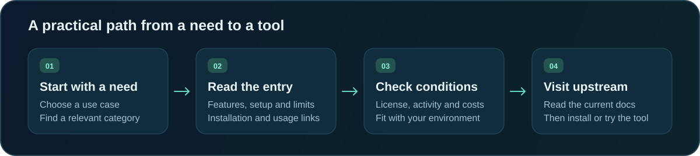

<p align="center">
  
</p>

<a id="ai-station"></a>

<h1 align="center">ai-station</h1>

<p align="center">A bilingual GitHub tool catalog. Find a purpose, check the fit.</p>

<p align="center">
  <a href="#included"></a>
  <a href="#categories"></a>
  
</p>

<p align="center"><a href="README.md">简体中文</a> · <strong>English</strong></p>

<p align="center"><a href="#featured">Featured</a> · <a href="#categories">Categories</a> · <a href="#criteria">Criteria</a> · <a href="reviews/2026-11-16-wechat.md">Review record</a></p>

<p align="center">
  
</p>

The catalog contains **395 included projects** across nine categories. Each project has one bilingual page covering its purpose, features, requirements, limitations, getting started and review evidence.

**Added on 2026-11-17:** [100 repositories that help AI complete tasks](reviews/2026-11-17-ai-repository-shortlist.md) now have complete bilingual entries in the directory below. The discovery record retains Star snapshots and recent activity, grouped into 12 task areas.

**Media additions:** Seven new [media entries](#included-media) cover video creation, image generation and segmentation, and searchable photo and video libraries.

**Media search additions:** [SCM](docs/scm.md#english) searches local media on a Mac. [FiftyOne](docs/fiftyone.md#english) supports visual dataset search, curation and evaluation.

Use it to find tools for a task, compare setup requirements or explore code worth learning from. Read the catalog in your browser, then follow the selected project's own setup guide.

<a id="start"></a>

## Find a tool

1. **Start with a task.** Try the [featured entries](#featured) or choose one of the [nine categories](#categories).
2. **Narrow the list.** Expand a category and use Ctrl/⌘+F for a name or purpose. GitHub repository search also covers the individual pages in `docs/`.
3. **Check the fit.** Open the entry, read its environment and usage limits, check the review date, then continue to the upstream documentation.

<p align="center">
  
</p>

<a id="featured"></a>

## Featured starting points

Six entries for common tasks. Selection reflects documented use cases; it is not a ranking or a claim of hands-on testing.

| What you want to do | Entry | Check before using |
| --- | --- | --- |
| Find models that fit your machine | [llmfit](docs/llmfit.md#english) | Estimates RAM and VRAM fit; estimates are not measured speed. |
| Diagram your technology stack | [Stack Diagram](docs/stack-diagram.md#english) | Exports SVG, HTML or PNG; PNG needs browser dependencies. |
| Create videos with web technology | [Hyperframes](docs/hyperframes.md#english) | Renders HTML/CSS animation to MP4; needs Node.js, FFmpeg and Chromium. |
| Organize research notes and long-form writing | [Zettlr](docs/zettlr.md#english) | Markdown, citations and exports; configure bibliography and export tools. |
| Monitor hosts and services | [Netdata Agent](docs/netdata.md#english) | Covers the open-source Agent core; the Web UI and Cloud have separate licenses. |
| Connect mobile devices to agents | [Mobile MCP](docs/mobile-mcp.md#english) | Controls Android/iOS apps; needs an MCP client and platform device tools. |

<a id="criteria"></a>

## Inclusion criteria

Future additions and reassessments use three criteria:

1. **Helps AI complete a task.** The project is AI-related and has an identifiable use, such as model execution, agent tools, coding, retrieval or content processing.
2. **Activity within three calendar months.** Provide a traceable commit, PR, issue or release link and date. Documentation updates and bot commits count; feature changes or bug fixes are not required. `pushed_at` alone does not identify a specific event.
3. **Meets the Star threshold.** Either **at least 1,000 total Stars** or **at least 500 net new Stars within one calendar month**. Record snapshot dates and, when using the growth condition, verifiable data for that window.

Each window ends on the review date and extends back by the relevant number of calendar months. Licensing is not an admission condition; license reviews and file hashes are not required.

These criteria apply to future additions and reassessments from **2026-11-17**. At the user's direction, **all 275 projects present at the policy transition remain formally included**, including 29 former candidates promoted in this update. This does not mean each project has been rechecked against the new criteria. Existing entry facts, snapshot dates and historical assessments are retained. Inclusion does not establish performance, compatibility or security through runtime testing.

This transition applies to the original assessment records. Future reassessments must provide new evidence against the current criteria.

**Explicit exception:** On 2026-11-17, the user specifically requested formal inclusion of [SCM](docs/scm.md#review-evidence). Its snapshot has 529 Stars; net growth over the past calendar month remains unverified. Only its Star criterion is waived for this assessment. AI task relevance and activity within three months were checked. The exception is bound to this assessment in `catalog-policy.json` under `explicit_admissions`; it does not apply to other projects or future reassessments.

<a id="categories"></a>

## Browse by category

Choose a category, then expand its list. Each of the 395 projects appears once in the directory, under its primary use.

| Category | Find | Count |
| --- | --- | ---: |
| [AI tools](#included-ai) | Models, agents, memory and knowledge bases | [98](#included-ai) |
| [Development](#included-development) | Coding, review, interfaces and engineering | [101](#included-development) |
| [Images, audio and video](#included-media) | Images, animation, audio and video creation | [68](#included-media) |
| [Documents and productivity](#included-productivity) | Writing, notes, office and everyday tools | [60](#included-productivity) |
| [Automation](#included-automation) | Scheduling, devices and application control | [20](#included-automation) |
| [Deployment and operations](#included-operations) | Deployment, monitoring, systems and services | [19](#included-operations) |
| [Data processing](#included-data) | Data queries, research and analysis | [22](#included-data) |
| [Terminal and shell](#included-terminal) | Terminals and command-line tools | [3](#included-terminal) |
| [Knowledge and learning](#included-knowledge) | Textbooks, atlases and interactive learning | [4](#included-knowledge) |

<a id="included"></a>

## Included (395)

Open a name for its bilingual entry and dated evidence. Stars below are review-time snapshots, not a live ranking.

<a id="included-ai"></a>

<details>
<summary><strong>AI tools</strong> · 98 projects</summary>

| Project | Purpose | Category | Stars |
| --- | --- | --- | ---: |
| [Agency Agents](docs/agency-agents.md#english) | Provides AI-agent instructions, workflows and deliverable templates organized by professional role. | AI tools | 168864 |
| [Agent Beacon](docs/agent-beacon.md#english) | Collects coding-agent session traces and makes reviewed working knowledge reusable by later agents. | AI tools | 3543 |
| [Agent Reach](docs/agent-reach.md#english) | Gives agents search and reading tools across websites, video platforms, forums and several Chinese services. | AI tools | 112225 |
| [Agenta](docs/agenta.md#english) | Builds shared team agents through conversation, with connected apps and scheduled or event-triggered runs. | AI tools | 4915 |
| [Agno](docs/agno.md#english) | Deploys agents, teams and workflows as services with APIs, MCP, storage and scheduling. | AI tools | 43216 |
| [ai-memory](docs/ai-memory.md#english) | Shared project memory for coding assistants, with searchable notes, session handoffs and optional document import and summaries. | AI tools | 15919 |
| [AirLLM](docs/airllm.md#english) | Reduce LLM VRAM demand by loading and offloading weights layer by layer, with streamed LoRA training interfaces for selected models. | AI tools | 42524 |
| [AstrBot](docs/astrbot.md#english) | Connect LLM conversations and agents to messaging platforms, with plugins, knowledge bases and a web administration interface. | AI tools | 47065 |
| [Axolotl](docs/axolotl.md#english) | A tool for organizing language-model fine-tuning and post-training through configuration files. | AI tools | 12735 |
| [bitsandbytes](docs/bitsandbytes.md#english) | A library providing low-bit quantization and optimizers for PyTorch. | AI tools | 8543 |
| [Cherry Studio](docs/cherry-studio.md#english) | A desktop AI workspace combining model conversations, agents, knowledge bases, and file tools. | AI tools | 53595 |
| [Claude Skills by Alireza Rezvani](docs/alirezarezvani-claude-skills.md#english) | Provides skills, role instructions and helper scripts for AI agents across engineering, product, marketing, finance and compliance. | AI tools | 29928 |
| [Claude-Mem](docs/claude-mem.md#english) | Records coding-agent observations and retrieves relevant memory in later sessions. | AI tools | 117552 |
| [Codex ChatGPT Web Bridge](docs/codex-chatgpt-web.md#english) | Provides a third-party bridge from a signed-in local ChatGPT Web session to Codex. | AI tools | 15746 |
| [colibri](docs/colibri.md#english) | Runs local models with C inference engines that load weights from RAM and disk on demand, with optional GPU acceleration. | AI tools | 51605 |
| [CrewAI](docs/crewai.md#english) | Organizes multistep work through role-based agents and event-driven workflows. | AI tools | 61025 |
| [DeepInfer](docs/deepinfer.md#english) | An inference implementation for DeepSeek models with optimized compute and distributed execution components. | AI tools | 26102 |
| [DeepSeek chat-demo](docs/deepseek-chat-demo.md#english) | A static chat interface for the DeepSeek API, with streaming replies, conversation branches, attachments and history import/export. | AI tools | 3890 |
| [DeepSpeed](docs/deepspeed.md#english) | A distributed optimization library for model training and inference. | AI tools | 43332 |
| [DeepTutor](docs/deeptutor.md#english) | Combines learning materials, tutoring conversations, practice and study records in an AI learning workspace. | AI tools | 59827 |
| [DeerFlow](docs/deer-flow.md#english) | Combines subagents, memory, skills and sandboxes to carry out extended tasks. | AI tools | 85439 |
| [Dify](docs/dify.md#english) | Builds AI workflows, retrieval pipelines and agents in a visual workspace. | AI tools | 161353 |
| [DSH Desktop](docs/dsh-desktop.md#english) | A DeepSeek Harness desktop workspace for models, Office templates, skills and plugins, supporting document, spreadsheet and presentation workflows. | AI tools | 19341 |
| [dsh-superagent 研究原型](docs/dsh-superagent-prototype.md#english) | Research code for an agent that monitors one GitHub repository and optionally Feishu, then works on authorized tasks. | AI tools | 23202 |
| [DSPy](docs/dspy.md#english) | Organizes model calls as modular programs and optimizes prompts or model parameters. | AI tools | 39107 |
| [fast-agent](docs/fast-agent.md#english) | Provides terminal agents, skills, MCP connections, shell tools and workflows across model providers. | AI tools | 3972 |
| [FreeLLM API](docs/freellmapi.md#english) | Combines the user's own model-provider accounts behind a local gateway with OpenAI-compatible endpoints, routing, failover and quota tracking. | AI tools | 53227 |
| [FreeToken](docs/freetoken.md#english) | A local mixture-of-experts inference engine that combines GPU, CPU and system memory with expert caching and serving APIs. | AI tools | 17244 |
| [Gemini CLI](docs/gemini-cli.md#english) | A terminal AI agent maintained for enterprise Gemini Code Assist workflows, with code inspection, file editing and tool execution. | AI tools | 108884 |
| [Geo Sleuth](docs/geo-sleuth.md#english) | Provides an agent workflow for locating photos from terrain, skylines, roads and map searches, returning candidate locations, viewing directions and evidence. | AI tools | 7109 |
| [Graphiti](docs/graphiti.md#english) | Builds context graphs that retain time and provenance, with semantic, keyword and graph-traversal retrieval. | AI tools | 32877 |
| [Haystack](docs/haystack.md#english) | A Python framework for composing language-model applications with components, pipelines, and agents. | AI tools | 27027 |
| [Heretic](docs/heretic.md#english) | A tool for studying language-model style, refusal and sycophancy through training-free parameter modification. | AI tools | 40743 |
| [Hindsight](docs/hindsight.md#english) | Stores facts and experiences for agents and retrieves or synthesizes relevant memory. | AI tools | 61351 |
| [Jev Chat Jarvis](docs/jev-chat-jarvis.md#english) | An Android chat-assistance overlay that uses accessibility and OCR to read current conversation context, analyze it and draft replies for user-selected insertion. | AI tools | 8409 |
| [LangChain](docs/langchain.md#english) | Builds agents and LLM applications from models, tools and third-party integrations. | AI tools | 149768 |
| [Langflow](docs/langflow.md#english) | Builds agents and workflows visually and exposes them through API and MCP servers. | AI tools | 156718 |
| [LangGraph](docs/langgraph.md#english) | Builds agent workflows with state, durable execution and human intervention. | AI tools | 45067 |
| [Laya](docs/laya.md#english) | A non-autoregressive decision engine for classification, choice selection, scoring and routing, producing structured outputs and confidence information. | AI tools | 35592 |
| [Laya-MLX](docs/laya-mlx.md#english) | Runs structured selection, scoring and boolean decisions through MLX on Apple Silicon. | AI tools | 7107 |
| [LibreChat](docs/librechat.md#english) | A self-hosted workspace for conversations with multiple models, agents, files, and tools. | AI tools | 47227 |
| [LightRAG](docs/lightrag.md#english) | A RAG framework combining knowledge graphs and vector retrieval. | AI tools | 40741 |
| [llama.cpp](docs/llama-cpp.md#english) | A ggml-based C/C++ inference engine with local command-line tools, serving interfaces and multimodal model support. | AI tools | 135378 |
| [LlamaFactory](docs/llamafactory.md#english) | A tool for configuring language-model fine-tuning through a CLI and web interface. | AI tools | 76084 |
| [LlamaIndex Framework](docs/llama-index.md#english) | A framework for RAG and agent applications that connects data, indexes, and language models. | AI tools | 52926 |
| [llmfit](docs/llmfit.md#english) | Detects CPU, RAM and GPU memory to estimate local model and quantization fit, exposing TUI, web, CLI/API and benchmarking interfaces. | AI tools | 39014 |
| [LMDeploy](docs/lmdeploy.md#english) | A toolkit for compressing, running, and serving language and vision-language models. | AI tools | 8149 |
| [LobeHub](docs/lobehub.md#english) | An AI workspace for model conversations, agent collaboration, and tool integrations, with a self-hosting option. | AI tools | 85696 |
| [Magpie](docs/magpie.md#english) | A local gateway that routes coding-agent requests across configured model providers and accounts, with optional failover and masking. | AI tools | 36740 |
| [Mem0](docs/mem0.md#english) | Extracts, stores and retrieves user, session and task memories for agents and applications. | AI tools | 69107 |
| [micrograd](docs/micrograd.md#english) | A small scalar reverse-mode autodifferentiation engine with a basic neural-network module for learning. | AI tools | 18968 |
| [MiniMind](docs/minimind.md#english) | Teaches language-model implementation from pretraining and fine-tuning to inference serving using small models. | AI tools | 65498 |
| [MiroFish](docs/mirofish.md#english) | Builds multi-agent simulation environments from input materials to explore group interactions and scenarios. | AI tools | 85784 |
| [MLX LM](docs/mlx-lm.md#english) | A Python package for text generation and language-model fine-tuning on Apple silicon with MLX. | AI tools | 7671 |
| [Not Sandboxed（Cybersecurity Projects 子项目）](docs/cybersecurity-projects.md#english) | The LLM prompt-injection defense component of Cybersecurity Projects, offering a Python library, CLI and experimental proxy for provenance, tool policies and output checks. | AI tools | 9554 |
| [Octop](docs/octop.md#english) | A self-hosted multi-user, multi-agent assistant with expert libraries, web/CLI/messaging access, scheduled tasks, knowledge bases and MCP/ACP interfaces. | AI tools | 12113 |
| [Ollama](docs/ollama.md#english) | Download, manage and run language models, exposing model access to applications and agents through a CLI and local API. | AI tools | 187285 |
| [oMLX](docs/omlx.md#english) | A local model-serving system with menu-bar management for Apple-silicon Macs. | AI tools | 23663 |
| [Open Interpreter](docs/open-interpreter.md#english) | The current mainline is a Rust terminal coding agent with model-provider integration, tool use, MCP/ACP, skills and native sandboxing. | AI tools | 68895 |
| [Open WebUI](docs/open-webui.md#english) | A self-hosted AI web interface for local models and services with compatible APIs. | AI tools | 158918 |
| [OpenAI Agents SDK](docs/openai-agents-python.md#english) | Provides agents, tools, handoffs, tracing and voice components for multi-agent workflows. | AI tools | 30735 |
| [OpenBot application template](docs/copilotkit-openbot.md#english) | An open-source application template for AI coworker workspaces connecting models, AG-UI agents and MCP tools; operation requires separately licensed CopilotKit Intelligence. | AI tools | 12624 |
| [OpenCode](docs/opencode.md#english) | Uses models in terminal or desktop interfaces to explore, plan and modify code. | AI tools | 227359 |
| [OpenDots](docs/opendots.md#english) | A community starter for persistent AI coworkers, with web, mobile and messaging interactions and per-agent computer workspaces. | AI tools | 6624 |
| [OpenFuse（原OpenMuse）](docs/openfuse.md#english) | Provides a personal-agent application template with a browser, terminal and file workspace. | AI tools | 6496 |
| [OpenHands](docs/openhands.md#english) | An agent workspace for software development with conversations, tool execution and change review. | AI tools | 93582 |
| [OpenMAIC](docs/openmaic.md#english) | Turns topics or documents into interactive classrooms with AI teachers and classmates. | AI tools | 43722 |
| [OpenMausBot](docs/openmausbot.md#english) | A desktop chat interface for coordinating agents with separate models, workspaces and connected applications. | AI tools | 23982 |
| [OpenRLHF](docs/openrlhf.md#english) | A language-model reinforcement-learning framework built on Ray, vLLM, and DeepSpeed. | AI tools | 10162 |
| [OpenViking](docs/openviking.md#english) | Organizes agent knowledge, memory and skills in a browsable virtual filesystem. | AI tools | 42305 |
| [Paperclip](docs/paperclip.md#english) | Coordinates AI teams through organizations, goals, tasks, permissions and budgets, connecting existing agents and tracking execution and model costs. | AI tools | 114265 |
| [PEFT](docs/peft.md#english) | A library for adapting pretrained models by training a subset of parameters. | AI tools | 21899 |
| [PilotDeck](docs/pilotdeck.md#english) | Organizes agent tasks, memory, skills and long-running work around separate workspaces. | AI tools | 4998 |
| [Prime Agent](docs/prime-agent.md#english) | Executes coding and research tasks through a persistent Python environment, subagents and background sessions. | AI tools | 22746 |
| [Pydantic AI](docs/pydantic-ai.md#english) | Provides typed agent loops, tool calls, durable execution, evaluations and model-provider interfaces. | AI tools | 21255 |
| [Qwen Code](docs/qwen-code.md#english) | An AI coding agent for terminals, editors and desktops that explores repositories, edits code and invokes development tools. | AI tools | 30668 |
| [RAGFlow](docs/ragflow.md#english) | A RAG engine combining document parsing, knowledge organization, and agentic retrieval. | AI tools | 94306 |
| [Rakazo](docs/rakazo.md#english) | A self-hostable AI team workspace with persistent memory, routines and agent computers. | AI tools | 8776 |
| [Ruflo](docs/ruflo.md#english) | Provides task orchestration, shared memory and MCP tool integration for coding agents. | AI tools | 81892 |
| [SGLang](docs/sglang.md#english) | An inference framework for language, multimodal, and diffusion models. | AI tools | 38977 |
| [Skid Homework](docs/skid-homework.md#english) | A browser-based study assistant that uses multimodal models to analyze question images, PDFs and text and explain solutions. | AI tools | 1947 |
| [smolagents](docs/smolagents.md#english) | Lets agents express actions as code, with multiple models, MCP tools and sandboxed execution options. | AI tools | 30404 |
| [StarNet](docs/starnet.md#english) | A desktop workspace that represents working agents as a pixel-art space station. | AI tools | 1854 |
| [Suparagent](docs/suparagent.md#english) | A workspace for named agents with conversations, workspaces, memory, routines and approval controls. | AI tools | 7087 |
| [Supermemory](docs/supermemory.md#english) | Provides memory and context APIs, assistant plugins and MCP access for extracting facts and retrieving history. | AI tools | 31641 |
| [SuperMimic](docs/supermimic.md#english) | A humanoid motion-tracking research implementation that trains whole-body control with a differentiable world model. | AI tools | 1646 |
| [TensorRT-LLM](docs/tensorrt-llm.md#english) | An inference optimization library for language models and visual generation on NVIDIA GPUs. | AI tools | 15084 |
| [TimesFM（开源代码与 ≤2.5 权重）](docs/timesfm.md#english) | Google Research's time-series forecasting codebase provides pretrained-model inference, quantile forecasts and covariate support. This entry covers Apache-2.0 source code and open weights through version 2.5. | AI tools | 35602 |
| [Transformers](docs/transformers.md#english) | A Python framework for loading, training and running text, vision, audio and multimodal models. | AI tools | 169089 |
| [TRL](docs/trl.md#english) | A post-training library with trainers for supervised fine-tuning, preference optimization, and reinforcement learning. | AI tools | 19750 |
| [Unsloth](docs/unsloth.md#english) | Tools for running and fine-tuning language, diffusion, speech and embedding models, including local desktop/Studio workflows. | AI tools | 79601 |
| [uzu](docs/uzu.md#english) | A Rust engine with language bindings for embedding model downloads, chat sessions and local inference in applications. | AI tools | 3358 |
| [verl](docs/verl.md#english) | A library for composing reinforcement-learning workflows from model training, rollout generation, and reward computation. | AI tools | 24264 |
| [vLLM](docs/vllm.md#english) | An inference and serving framework for language and multimodal models, with request batching, distributed inference and APIs compatible with common clients. | AI tools | 97064 |
| [WeKnora](docs/weknora.md#english) | An enterprise-document knowledge base and RAG service combining parsing, retrieval, agents and wiki workflows. | AI tools | 37540 |
| [XERJ](docs/xerj.md#english) | An open-source search engine for AI agents, indexing code, documents and logs for full-text, vector and hybrid retrieval. | AI tools | 19162 |
| [微舆（BettaFish）](docs/bettafish.md#english) | Multi-agent research software that combines web, social and database material into public-opinion reports. | AI tools | 42701 |
| [Last30Days Skill](docs/last30days-skill.md#english) | An AI agent-led search engine that scores multiple platforms by real engagement and synthesizes a grounded brief for research tasks. | AI tools | 69671 |

</details>

<a id="included-development"></a>

<details>
<summary><strong>Development</strong> · 101 projects</summary>

| Project | Purpose | Category | Stars |
| --- | --- | --- | ---: |
| [2010 Rust Rewrite Mashup](docs/2010-rust-rewrite-mashup.md#english) | A Rust game-mashup experiment combining MW2-style environments, skating and voxel maps for studying game reimplementation and asset compatibility. | Development | 951 |
| [agent-browser](docs/agent-browser.md#english) | Provides web snapshots, element actions and browser-session commands for AI agents. | Development | 52076 |
| [AI Infra Book](docs/ai-infra-book.md#english) | An AI infrastructure textbook and calculation toolkit covering hardware, model architecture, inference and training, with web, PDF/EPUB and capacity-planning scripts. | Development | 7897 |
| [AI Website Cloner Template：网站复刻与迁移模板](docs/ai-website-cloner-template.md#english) | A Next.js template and agent workflow for observing existing webpages and rebuilding their layout, assets and interactions as editable code. | Development | 39159 |
| [AnyPS5](docs/anyps5.md#english) | A compatibility project for relinking console executables to desktop platforms. | Development | 54377 |
| [Archify](docs/archify.md#english) | Turns ideas, plans and repository material into interactive HTML diagrams and explanatory pages with source references. | Development | 96538 |
| [assistant-ui](docs/assistant-ui.md#english) | A TypeScript component library for building AI chat interfaces in React applications. | Development | 13288 |
| [Chainlit](docs/chainlit.md#english) | Build conversational AI applications in Python, with browser views for messages and tool execution steps. | Development | 12503 |
| [Claude Code Game Studios](docs/claude-code-game-studios.md#english) | A Claude Code template and skill collection for turning a game idea into a brief, browser prototype and incremental implementation. | Development | 39708 |
| [Claude Code Templates](docs/claude-code-templates.md#english) | Provides a component catalog and CLI installer for Claude Code skills, subagents, commands, hooks, MCP configurations and plugins. | Development | 33885 |
| [Claude Community Plugins：目录与校验器](docs/claude-plugins-community.md#english) | Provides a Claude community plugin directory and a reusable marketplace CI validator. | Development | 4903 |
| [Claude Plugins Official](docs/claude-plugins-official.md#english) | Anthropic's plugin directory for extending Claude development and work workflows. | Development | 47430 |
| [Claude Red](docs/claude-red.md#english) | A Claude Code skill collection for authorized security research and CTF work. | Development | 11091 |
| [CLI-Anything](docs/cli-anything.md#english) | A framework for building command-line interfaces that drive real application backends, including JSON output and interactive workflows. | Development | 58741 |
| [Code-Graph-RAG](docs/code-graph-rag.md#english) | Parses multilingual repositories into a knowledge graph for agents to retrieve code structure, answer questions and assist with edits. | Development | 5369 |
| [code-review-graph](docs/code-review-graph.md#english) | Builds an incremental local code graph for dependency queries, impact exploration and review context. | Development | 32776 |
| [Codex CLI](docs/codex.md#english) | A coding agent that works in local projects through terminal and editor interfaces. | Development | 135635 |
| [Codex with ChatGPT](docs/codex-with-chatgpt.md#english) | Connects ChatGPT web planning and review to a Codex workspace through a read-only MCP bridge. | Development | 7718 |
| [CopilotKit](docs/copilotkit.md#english) | A framework for connecting agents to applications through chat, generated interfaces, and human approval components. | Development | 38763 |
| [Cordis](docs/cordis.md#english) | A TypeScript framework for components, service dependencies and lifecycle management. | Development | 9915 |
| [Craft Anything](docs/craft-anything.md#english) | An early application-research and rebuilding workspace that combines inspection, agent-assisted implementation and comparison. | Development | 33239 |
| [DeepEval](docs/deepeval.md#english) | Evaluates LLM applications, agent trajectories and individual steps using automated metrics. | Development | 19527 |
| [E2B](docs/e2b.md#english) | Manages isolated execution environments for agents through Python and JavaScript SDKs. | Development | 14906 |
| [ECC](docs/ecc.md#english) | Combines planning, review, memory, context management and engineering checks for coding agents. | Development | 304243 |
| [ego-browser for ego lite](docs/ego-lite.md#english) | An open-source skill and tool layer connecting AI agents to the ego lite browser, with JavaScript page actions and separate task workspaces. | Development | 23215 |
| [Expo Skills](docs/expo-skills.md#english) | Supplies AI coding agents with workflows for Expo development, upgrades, debugging and EAS delivery. | Development | 4177 |
| [FastAPI-MCP](docs/fastapi-mcp.md#english) | Exposes FastAPI routes as MCP tools while reusing application schemas and dependency-based authentication. | Development | 12029 |
| [FastMCP (Python)](docs/fastmcp.md#english) | Builds MCP servers, clients and interactive applications in Python. | Development | 28617 |
| [Flutter](docs/flutter.md#english) | A Dart UI toolkit for building mobile, web and desktop applications. | Development | 181237 |
| [Garden Skills](docs/garden-skills.md#english) | Reusable skills, scripts and templates for AI coding agents, covering web design, presentations, image creation and local knowledge retrieval. | Development | 15316 |
| [Ghidra](docs/ghidra.md#english) | A reverse-engineering framework for compiled programs with disassembly, decompilation and scripting. | Development | 100277 |
| [GitHub MCP Server](docs/github-mcp-server.md#english) | GitHub's official MCP server exposes repositories, code and collaboration workflows to agents. | Development | 34544 |
| [Godogen](docs/godogen.md#english) | Uses coding agents to generate standalone game projects and assets for targets including Godot, Bevy, Babylon.js and Three.js, with runtime verification workflows. | Development | 7354 |
| [GPUI Kit](docs/gpui-kit.md#english) | A Rust GPUI desktop component library with tables, editors, layouts, accessibility support and an optional JavaScript host. | Development | 20833 |
| [Gradio](docs/gradio.md#english) | Build interactive web interfaces for models, APIs, or functions using Python. | Development | 44073 |
| [Graphify](docs/graphify.md#english) | Builds queryable graphs from code and other materials, supporting relationship exploration and visual explanations. | Development | 148039 |
| [Guidance](docs/guidance.md#english) | Combines model generation with Python control flow and output constraints expressed as regex or grammars. | Development | 21825 |
| [Hallmark](docs/hallmark.md#english) | An agent skill for choosing visual styles, building interfaces and checking page design. | Development | 55872 |
| [Henge](docs/henge.md#english) | A JIT emulator for running macOS on iPhone and iPad for compatibility experiments. | Development | 2357 |
| [Impeccable](docs/impeccable.md#english) | Provides frontend design, review and refinement commands for coding agents. | Development | 111148 |
| [Instructor](docs/instructor.md#english) | Parses model responses into typed data with Pydantic, validation and retries. | Development | 14118 |
| [islandcn](docs/islandcn.md#english) | A Dynamic Island-style activity component for React, with state management, transitions, animation and reusable presets. | Development | 760 |
| [JADX](docs/jadx.md#english) | A decompiler that turns Android DEX, APK and Java bytecode into readable Java source. | Development | 51846 |
| [LASRecomp](docs/lasrecomp.md#english) | Recompiles the Switch edition of Link's Awakening into native desktop or mobile programs with graphics, input and platform compatibility code. | Development | 2451 |
| [Letta Code](docs/letta-code.md#english) | A terminal agent harness with persistent memory, skills and state across sessions. | Development | 3862 |
| [Lightpanda Browser](docs/lightpanda.md#english) | A headless browser for automation and agents, with JavaScript execution, page interaction and HTML, Markdown or structured extraction. | Development | 42129 |
| [LiveKit Agents](docs/agents.md#english) | LiveKit's Python agent framework for real-time voice and multimodal conversations. | Development | 15259 |
| [LM Evaluation Harness](docs/lm-evaluation-harness.md#english) | Runs language-model benchmarks through configurable tasks, metrics and model backends. | Development | 14492 |
| [MacNativeGames](docs/macnativegames.md#english) | Explores adapting selected games' graphics and system calls to Apple silicon and Metal. | Development | 7913 |
| [MCP Reference Servers](docs/servers.md#english) | Official MCP reference servers demonstrating tools, resources and data access. | Development | 92065 |
| [mcpo](docs/mcpo.md#english) | Proxies MCP servers as OpenAPI HTTP endpoints for AI applications. | Development | 4429 |
| [MiniMax Skills](docs/minimax-skills.md#english) | Provides frontend, full-stack and mobile-development skills for coding agents, alongside document workflows and MiniMax multimodal asset generation. | Development | 13846 |
| [MLX](docs/mlx.md#english) | A machine-learning framework providing array computation, automatic differentiation, and neural-network components. | Development | 29192 |
| [Moli：面向 AI 智能体的无头浏览器](docs/moli.md#english) | A Rust headless browser for JavaScript execution, page extraction and browser automation, with optional layout, screenshots and PDF output. | Development | 23783 |
| [Nextpad++ for macOS](docs/nextpad-plus-plus-macos.md#english) | A macOS adaptation of the Notepad++ editing workflow, including tabs, search, highlighting, macros and plugin migration. | Development | 1445 |
| [nxnative](docs/nxnative.md#english) | Translates user-owned Switch game programs into native Apple applications, with Horizon and graphics compatibility layers for static-recompilation research. | Development | 15844 |
| [Obscura](docs/obscura.md#english) | A Rust headless browser for AI agents and web extraction, with V8 JavaScript execution and CDP and MCP interfaces. | Development | 36016 |
| [Open Code Review](docs/open-code-review.md#english) | Reviews Git diffs or whole files with a configurable model and produces line-level findings. | Development | 52711 |
| [OpenCompass](docs/opencompass.md#english) | Configures model inference, benchmark evaluation and result summaries in a common workflow. | Development | 7599 |
| [OpenSmash-Ultimate](docs/opensmash-ultimate.md#english) | A static-recompilation project for running a specific, user-supplied Switch game on desktop platforms. | Development | 188 |
| [OpenTest（功能待公开）](docs/opentest.md#english) | A public repository whose available introduction only announces a forthcoming project. | Development | 3 |
| [Orca（智能体开发工作台）](docs/orca.md#english) | A coding-agent workspace with multiple project views, terminals, change review, remote SSH and mobile companions. | Development | 125338 |
| [Outlines](docs/outlines.md#english) | Defines model output structures using Python types, Pydantic models and constrained generation. | Development | 16013 |
| [Pipecat](docs/pipecat.md#english) | A Python framework for composing processing pipelines for real-time voice and multimodal agents. | Development | 17304 |
| [Plannotator](docs/plannotator.md#english) | Provide a local browser review interface for AI agents, annotating plans, documents, web artifacts and code diffs and returning feedback to the session. | Development | 12679 |
| [Ponytail](docs/ponytail.md#english) | Helps coding agents reuse existing implementation, review changes and record task cost and test status. | Development | 191880 |
| [PR-Agent](docs/pr-agent.md#english) | Use LLMs to analyze pull requests, generate change descriptions and reviews, and answer questions about diffs. | Development | 16305 |
| [Promptfoo](docs/promptfoo.md#english) | Compares prompts and models through configuration-driven evaluations, red-team tests and CI checks. | Development | 27370 |
| [Public APIs](docs/public-apis.md#english) | A categorized directory of APIs and MCP-related services, with indicators such as authentication, HTTPS and CORS. | Development | 499152 |
| [PyTorch](docs/pytorch.md#english) | A deep-learning framework providing tensor computation, automatic differentiation, and neural-network components. | Development | 105706 |
| [Ragas](docs/ragas.md#english) | Evaluates LLM applications and generates test data using model-based and traditional metrics. | Development | 16354 |
| [REA — Reverse Engineer Anything](docs/rea.md#english) | CLI and MCP tooling for examining binaries, JavaScript, desktop apps and websites with multiple analysis backends. | Development | 460761 |
| [S2Arm](docs/s2arm.md#english) | Translates supported, user-supplied Switch games into ARM64 programs for Apple devices, with graphical packaging and library management. | Development | 3346 |
| [Screenshot to Code](docs/screenshot-to-code.md#english) | Generates and iterates on web-interface code from screenshots, designs or screen recordings. | Development | 81243 |
| [Security Audit Skill](docs/security-audit-skill.md#english) | A source-security audit skill with validators for coverage records and structured findings. | Development | 73608 |
| [Semantica](docs/semantica.md#english) | A library for organizing data into knowledge and context graphs with provenance and reasoning records. | Development | 14627 |
| [Serena](docs/serena.md#english) | Code navigation and editing tools that use language servers or an optional JetBrains integration to work with symbols. | Development | 31391 |
| [Skills For Real Engineers（Matt Pocock）](docs/skills.md#english) | Composable coding-assistant skills for requirements, architecture, implementation, review and refactoring. | Development | 324716 |
| [SkillSpector](docs/skillspector.md#english) | Scans agent skills for suspicious instructions, code behavior and security issues. | Development | 26363 |
| [Spec Kit](docs/spec-kit.md#english) | A toolkit for specification-driven development, connecting requirements, plans, tasks and implementation through agent workflows. | Development | 149841 |
| [Stack Diagram](docs/stack-diagram.md#english) | Turns stack descriptions into architecture diagrams with service icons and connections, exporting SVG, HTML and PNG in light or dark themes for project documentation. | Development | 2537 |
| [Stitch Design Skills](docs/stitch-skills.md#english) | Agent skills for UI design, design-system extraction and frontend implementation through Google Stitch MCP. | Development | 9786 |
| [Superpowers](docs/superpowers.md#english) | Provides coding agents with skills for requirements, planning, testing and code review. | Development | 318748 |
| [T3 Code](docs/t3code.md#english) | Manages coding-agent sessions, diffs and remote connections in one interface, with desktop, web and phone access. | Development | 62317 |
| [Taste Skill](docs/taste-skill.md#english) | Provides website design workflows, asset tools and browser checks for coding agents. | Development | 116605 |
| [Text to CAD](docs/text-to-cad.md#english) | Agent tools for turning design requests into parametric CAD scripts and manufacturing files. | Development | 26417 |
| [ThinkRail](docs/thinkrail.md#english) | Builds workspace, editor, change-review and project-specification tools around the pi coding agent. | Development | 8310 |
| [TokenEconomizer](docs/token-economizer.md#english) | Reuses repository experience, prunes unused tools and detects failure loops for coding agents, with session accounting that includes the plugin’s own model calls. | Development | 7272 |
| [Univer](docs/univer.md#english) | An embeddable spreadsheet and document SDK with formulas, rendering, editing and programmatic APIs, including headless processing. | Development | 27511 |
| [Universal Modder](docs/universal-modder.md#english) | Combines agent skills, the um CLI and a knowledge base for engine discovery, asset processing and in-game validation during mod development. | Development | 9725 |
| [Unreal Engine Skills for Claude Code](docs/unreal-engine-skills.md#english) | Skills and session hooks that guide Claude Code in operating Unreal Editor through MCP. | Development | 1980 |
| [Vercel Skills CLI](docs/vercel-skills.md#english) | A CLI for discovering, installing and managing AI coding-agent skills at project or global scope. | Development | 39716 |
| [Voxel Musou](docs/voxel-musou.md#english) | A browser Three.js voxel-action game with multiple characters, chapters and trials, useful for studying lightweight gameplay, rendering and local progress management. | Development | 178 |
| [vphone-cli](docs/vphone-cli.md#english) | Runs a virtual iPhone on Apple Silicon Macs for research and debugging. | Development | 16695 |
| [Wakaru](docs/wakaru.md#english) | A JavaScript decompiler that unbundles packages, expands minified code and restores some transpiled structures through a CLI or playground. | Development | 1090 |
| [Worktrunk](docs/worktrunk.md#english) | Simplifies switching, inspecting and removing Git worktrees for parallel coding tasks. | Development | 12565 |
| [Claude-BugHunter](docs/claude-bughunter.md#english) | A Claude Code skill bundle for authorized bug hunting and external red-team work that helps AI run security tests and reporting. | Development | 10641 |
| [SkillEvaluator](docs/skill-evaluator.md#english) | A multi-tier framework for evaluating AI agent skills and plugins on quality, security, overlap, compatibility, and real impact. | Development | 3513 |
| [Cursor Plugins](docs/cursor-plugins.md#english) | Official Cursor plugin specification and plugin collection for AI coding agents, offering developer, integration, and productivity plugins for code review, branch management, and third-party service operations. | Development | 17282 |
| [BLA (Blind LLM Agents)](docs/bla.md#english) | MCP server and CLI that lets AI coding agents harden software releases against AI reverse-engineering agents. | Development | 6188 |
| [App Store Compliance Playbook](docs/app-store-compliance.md#english) | A reference and pre-submission guard for App Store and Google Play rejections, installable as a skill into AI coding tools so agents audit apps and block risky submits. | Development | 1965 |

</details>

<a id="included-media"></a>

<details>
<summary><strong>Images, audio and video</strong> · 68 projects</summary>

| Project | Purpose | Category | Stars |
| --- | --- | --- | ---: |
| [15 种动态设计风格](docs/mg-styles-15.md#english) | Fifteen short motion-design examples with style prompts, source code and audio tooling. | Images, audio and video | 3540 |
| [3D Model Anything](docs/3d-model-anything.md#english) | Tools and agent workflows for turning room scans into editable Three.js scenes. | Images, audio and video | 3031 |
| [Abyssal Garden](docs/abyssal-garden.md#english) | An interactive underwater scene packaged as one HTML file, using WebGPU graphics and synthesized audio. | Images, audio and video | 1440 |
| [Anatomy](docs/anatomy.md#english) | Creates interactive isometric explanations of machines, instruments and mechanisms using browser-based graphics. | Images, audio and video | 27394 |
| [Animate 程序化动画](docs/animate.md#english) | Builds procedural Canvas animations with music and timed narration, then renders video using browser tools and FFmpeg. | Images, audio and video | 1967 |
| [Arnis](docs/arnis.md#english) | Converts geographic and elevation data into block-game worlds. | Images, audio and video | 18642 |
| [ArtCraft](docs/artcraft.md#english) | A desktop AI creation workspace combining 2D composition, 3D scenes and image/video models to organize generative media workflows. | Images, audio and video | 41207 |
| [ASCII](docs/ascii.md#english) | A TypeScript ASCII-animation library for React, Next.js, Astro, Web Components and plain HTML, with SVG output. | Images, audio and video | 1232 |
| [Awesome DESIGN.md](docs/awesome-design-md.md#english) | A collection of DESIGN.md analyses describing website colors, typography, layout and interface rules. | Images, audio and video | 127606 |
| [Bang Motion](docs/bang-motion.md#english) | Creates openers, promos, product clips and typography as a single HTML animation with optional video export. | Images, audio and video | 2201 |
| [cinecode](docs/cinecode.md#english) | An agent skill for making films with code, using browser scenes, sound design and FFmpeg to produce MP4 files. | Images, audio and video | 2593 |
| [Claude Animated Shorts](docs/claude-animated-shorts.md#english) | A Claude Code skill for vertical animated shorts, with Three.js and Remotion scenes, sound helpers and a bridge-story example. | Images, audio and video | 3658 |
| [Claude Animation Base](docs/claudeanimationbase.md#english) | A p5.js and p5.brush animation starter with drawing primitives, character scenes, timelines and MP4 rendering. | Images, audio and video | 2995 |
| [ComfyUI](docs/comfyui.md#english) | Build and reuse generative AI workflows for images, video, audio, and other media through node graphs. | Images, audio and video | 147310 |
| [CosyVoice](docs/cosyvoice.md#english) | A speech-generation toolkit supporting voice cloning, cross-language synthesis, and streaming output. | Images, audio and video | 24432 |
| [Deskworlds](docs/deskworlds.md#english) | Runs interactive local 3D scenes on the Mac desktop and in a browser. | Images, audio and video | 468 |
| [Diagram Design](docs/diagram-design.md#english) | An agent skill for producing standalone HTML and SVG diagrams of structures, processes and comparisons. | Images, audio and video | 67558 |
| [Diffusers](docs/diffusers.md#english) | A PyTorch-based diffusion library with pipelines for image, video, and audio generation. | Images, audio and video | 34932 |
| [F5-TTS](docs/f5-tts.md#english) | Generate speech from reference audio using command-line tools, a Gradio interface, and fine-tuning utilities. | Images, audio and video | 15607 |
| [faster-whisper](docs/faster-whisper.md#english) | A Python speech-transcription library that runs Whisper through CTranslate2. | Images, audio and video | 26823 |
| [Fish Speech](docs/fish-speech.md#english) | Models and inference tools for speech with multiple characters, voice cloning, and audio editing. | Images, audio and video | 33764 |
| [FunASR](docs/funasr.md#english) | An audio toolkit combining speech recognition, voice activity detection, punctuation, and speaker processing. | Images, audio and video | 21058 |
| [GIF 工厂 / GIF Factory](docs/gif-factory.md#english) | A collection of agent skills, examples and scripts for stickers, animated posters, signatures, storybooks and explanatory videos. | Images, audio and video | 1940 |
| [God's Eye View](docs/gods-eye-view.md#english) | An interactive 3D globe combining public transport, geographic and environmental data. | Images, audio and video | 65241 |
| [GPT-SoVITS](docs/gpt-sovits.md#english) | A WebUI and training toolkit for voice cloning, speech synthesis, and fine-tuning with small datasets. | Images, audio and video | 65252 |
| [Handy](docs/handy.md#english) | Shortcut-driven local speech recognition that pastes text into the current field, with model choices including Whisper and Parakeet. | Images, audio and video | 38948 |
| [Hex](docs/hex.md#english) | On-device dictation that pastes into the active application, with vocabulary, history, processing steps and file transcription. | Images, audio and video | 7045 |
| [Heytea Doodle Poster：实物照片与小人涂鸦](docs/heytea-style.md#english) | A food and product-image workflow that combines photography, black stick figures and open space. | Images, audio and video | 350 |
| [Holo Card Studio](docs/holo-card-studio.md#english) | Builds layered images into interactive holographic-card pages and editable Blender projects. | Images, audio and video | 2106 |
| [HolyArrs](docs/holyarrs.md#english) | A self-hosted web application for media requests, selection rules, subtitles and library imports, connecting existing downloaders and media servers. | Images, audio and video | 1325 |
| [Huashu Design](docs/huashu-design.md#english) | An agent skill for producing HTML designs, app prototypes, presentations, animations and explanatory graphics. | Images, audio and video | 29538 |
| [Hunyuan3D 2](docs/hunyuan3d-2.md#english) | Convert images into textured 3D assets through separate shape-generation and texture-synthesis stages. | Images, audio and video | 15462 |
| [Hyperframes](docs/hyperframes.md#english) | Creates videos from HTML/CSS and seekable animations, rendering MP4 with headless Chromium and FFmpeg through a CLI, agent skills or desktop studio. | Images, audio and video | 85034 |
| [Ian Xiaohei Illustrations](docs/ian-xiaohei-illustrations.md#english) | A Codex-oriented skill for turning Chinese article concepts into white-background hand-drawn Xiaohei illustrations. | Images, audio and video | 13217 |
| [Immich](docs/immich.md#english) | Immich is a self-hosted photo and video library with automatic mobile uploads, albums, face recognition, and CLIP search. | Images, audio and video | 119440 |
| [InvokeAI](docs/invokeai.md#english) | A local AI application for image creation, combining canvas editing, node workflows, and model management. | Images, audio and video | 29105 |
| [Lemo-Opuscar](docs/lemo-opuscar.md#english) | A motion-design library of style guides, prompts, code examples and demonstration films; the current README lists 99 styles. | Images, audio and video | 16446 |
| [LivePortrait](docs/liveportrait.md#english) | Animate human and animal portraits using driving video or motion templates. | Images, audio and video | 19514 |
| [LTX-2](docs/ltx-2.md#english) | A Python toolkit for synchronized audio-video generation, video transformations, and regenerating selected segments. | Images, audio and video | 10280 |
| [Mac Duo](docs/mac-duo.md#english) | Applies tilt, blur and dimming to live desktop content as a MacBook lid moves. | Images, audio and video | 1236 |
| [MCP for Blender](docs/mcp-for-blender.md#english) | Connects agents to Blender through MCP for scenes, models, materials and rendering, with optional asset-service integrations. | Images, audio and video | 34616 |
| [MoneyPrinterTurbo](docs/moneyprinterturbo.md#english) | Turns topics or keywords into scripts, narration, assets and subtitles, then composes short videos. | Images, audio and video | 144052 |
| [MyGo Music](docs/mygo-music.md#english) | A native desktop music player for local files, lyrics and playlists, with plugins for catalogs, podcasts and radio. | Images, audio and video | 1408 |
| [Open Generative AI](docs/open-generative-ai.md#english) | A self-hostable interface for AI image and video creation through MuAPI cloud models, with local inference-engine integrations in the desktop app. | Images, audio and video | 35058 |
| [OpenCreator](docs/opencreator.md#english) | Organizes content creation through conversation and a visual workspace, managing runs, media, subtitles and revisions. | Images, audio and video | 14380 |
| [Photo Relic Editorial：照片与纸上印迹](docs/photo-relic-editorial.md#english) | A photo-layout skill that pairs a photographic upper section with paper-like abstract editorial elements below. | Images, audio and video | 454 |
| [Photo-to-Zine：照片明信片正反面](docs/photo-to-zine-postcard.md#english) | A photo-preserving postcard workflow with doodles, color swatches and front/back layouts. | Images, audio and video | 289 |
| [PhotoPrism](docs/photoprism.md#english) | PhotoPrism is a self-hosted photo and video manager that generates labels, recognizes faces, and filters media by content and metadata. | Images, audio and video | 40456 |
| [Qwen-Image](docs/qwen-image.md#english) | Models and examples for text-to-image generation and image editing, including text rendering within images and editing with multiple input images. | Images, audio and video | 8487 |
| [Remotion](docs/remotion.md#english) | Creates videos with React and web technology, with coding-agent workflows, interactive previews and batch rendering. | Images, audio and video | 73840 |
| [SAM 3](docs/sam3.md#english) | Segment images and videos using text, points, boxes, or masks, and track objects across video frames. | Images, audio and video | 12319 |
| [SCM](docs/scm.md#english) | Index photos, screenshots, and videos locally on a Mac. Search by visual descriptions, visible text, or dialogue, and jump to matching moments in videos. | Images, audio and video | 529 |
| [Subvox](docs/subvox.md#english) | A small-vocabulary prototype testing whether AirPods head-motion data can identify silently mouthed words. | Images, audio and video | 838 |
| [SwarmUI](docs/swarmui.md#english) | An extensible web interface for image, video, and selected audio generation models. | Images, audio and video | 4791 |
| [Teardown：交互式机械拆解与3D演示](docs/teardown.md#english) | A Claude Code skill for interactive 3D mechanism explanations, exploded views, sections and recorded video. | Images, audio and video | 3534 |
| [Turbo Kart Rally](docs/turbo-kart-rally.md#english) | A Three.js browser kart racer and example of procedural game content. | Images, audio and video | 50 |
| [Upscayl](docs/upscayl.md#english) | A desktop tool that enlarges low-resolution images with AI super-resolution models, supporting batch processing and model selection. | Images, audio and video | 52784 |
| [VoiceStudio](docs/voicestudio.md#english) | Voice software for cloning, speech design, transcription and dubbing, with batch processing and agent interfaces. | Images, audio and video | 110994 |
| [Wan2.2](docs/wan2-2.md#english) | Models and inference code for text-to-video, image-to-video, and character animation. | Images, audio and video | 18725 |
| [Whisper](docs/whisper.md#english) | A multilingual speech-recognition model and toolkit for transcription, language detection and speech translation into English. | Images, audio and video | 112864 |
| [WhisperX](docs/whisperx.md#english) | Add word-level timestamps, alignment, and speaker diarization to Whisper transcription. | Images, audio and video | 25405 |
| [YuE2 推理代码 / YuE2 inference code](docs/yue.md#english) | Generates vocals and accompaniment from editable melody and chord plans. | Images, audio and video | 13534 |
| [产品宣传片制作](docs/video-shotcraft.md#english) | A product-video workflow that captures real webpages and builds editable Remotion-based timelines and export drafts. | Images, audio and video | 19790 |
| [代码手绘插画与动画](docs/anidoodle.md#english) | A code-based drawing and animation toolkit for stylized illustrations, characters and interactive browser output. | Images, audio and video | 1693 |
| [手绘口播视频](docs/sweety-handdraw-video.md#english) | A workflow for illustrated narration with local tracing, fills, handwriting and audio alignment, with newer portrait-film tooling. | Images, audio and video | 1218 |
| [拾景纸刊：照片与撕纸拼贴](docs/gathered-scenes-zine-skill.md#english) | A photo-collage skill that arranges fragments, illustration, structural colors and torn-paper elements, with an additional Live Photo workflow. | Images, audio and video | 5660 |
| [照片转海报：厚涂微缩景观与水彩旅行卡](docs/photo-to-poster-skills.md#english) | Photo-based prompts and workflows for painted miniature posters and watercolor travel-card imagery. | Images, audio and video | 36 |
| [花叔艺术动画](docs/huashu-art-motion.md#english) | An agent-oriented toolkit of art-motion styles, explanatory patterns and reusable animation clips. | Images, audio and video | 6941 |

</details>

<a id="included-productivity"></a>

<details>
<summary><strong>Documents and productivity</strong> · 60 projects</summary>

| Project | Purpose | Category | Stars |
| --- | --- | --- | ---: |
| [Aerial TV](docs/aerial-tv.md#english) | An Android TV launcher with app grids, folders, HDMI shortcuts, wallpaper screensavers and phone-based remote management. | Documents and productivity | 12155 |
| [AirCursor](docs/aircursor.md#english) | Turns motion from head-tracking headphones into Mac pointer movement and clicks. | Documents and productivity | 226 |
| [Animated Resume Claude Skill](docs/animated-resume-claude-skill.md#english) | Guides an AI assistant to turn resume facts into structured profile data and generate a single-page HTML portfolio with career levels, an animated avatar and a project graph. | Documents and productivity | 2 |
| [Anki Desktop](docs/anki.md#english) | Schedules flashcard reviews with spaced repetition. | Documents and productivity | 32834 |
| [Answer me with HTML](docs/answer-me-with-html.md#english) | An AI agent skill and local rendering CLI that turn Markdown answers into single-page HTML with diagrams, code and reader feedback. | Documents and productivity | 6390 |
| [Anthropic Skills](docs/anthropic-skills.md#english) | Anthropic’s agent-skill example repository; this entry focuses on the currently Apache-2.0-licensed Word, PDF, PowerPoint and spreadsheet skills and helper scripts. | Documents and productivity | 196194 |
| [best-skills](docs/best-skills.md#english) | A collection of agent workflows for papers, patents, presentations, graphics, code and document processing. | Documents and productivity | 3176 |
| [Call Notes to Actions](docs/call-notes-to-actions-skill.md#english) | A lightweight agent skill that turns meeting transcripts or rough notes into summaries, decisions, action tables and follow-up email drafts. | Documents and productivity | 0 |
| [CCBaga](docs/ccbaga.md#english) | Manages local Claude identity configuration, client tooling and a companion browser environment. | Documents and productivity | 3618 |
| [Clash 客户端导航（clashbk）](docs/clash.md#english) | A directory of proxy clients, download links, tutorials and historical backups. | Documents and productivity | 11389 |
| [Claude PowerPoint Skill](docs/claude-powerpoint-skill.md#english) | An AI coding-agent skill for building, linting and visually reviewing PowerPoint decks, with cross-platform PPTX generation and live PowerPoint automation on Windows. | Documents and productivity | 6 |
| [ColaMD](docs/colamd.md#english) | A cross-platform Markdown editor with WYSIWYG and source views, disk synchronization, outlines, themes and common document exports. | Documents and productivity | 1303 |
| [Docling](docs/docling.md#english) | A document parser that extracts layout and content into structured outputs. | Documents and productivity | 70696 |
| [Echo Loop](docs/echo-loop.md#english) | An English listening and speaking app organized around intensive listening, shadowing, retelling and review. | Documents and productivity | 4772 |
| [Filee](docs/filee.md#english) | A local file converter with optional Ollama document translation, Whisper audio/video transcription and AI image upscaling. | Documents and productivity | 28180 |
| [GenOffice](docs/genoffice.md#english) | An office workspace with desktop, CLI and MCP interfaces for editing, converting and searching documents. | Documents and productivity | 12376 |
| [Guizang PPT Skill](docs/guizang-ppt-skill.md#english) | Guides agents to create single-file HTML slide decks with magazine and Swiss-grid styles plus a local browser presenter view. | Documents and productivity | 29911 |
| [Horizon：AI 信息聚合与双语新闻简报](docs/horizon.md#english) | Collects information from RSS, communities and other configured sources, filters and scores it, and produces bilingual reading reports. | Documents and productivity | 14389 |
| [i-have-adhd](docs/i-have-adhd.md#english) | Adjusts coding-agent responses to make actions and key information easier to find. | Documents and productivity | 61361 |
| [Joplin 客户端 / Joplin clients](docs/joplin.md#english) | Organizes Markdown notes, tasks and attachments into notebooks with search and synchronization. | Documents and productivity | 57204 |
| [KISS Translator](docs/kiss-translator.md#english) | A browser extension and userscript for bilingual web reading, selection and subtitle translation, with a choice of conventional translation engines, cloud LLMs or local AI. | Documents and productivity | 13389 |
| [Knowledge Work Plugins](docs/knowledge-work-plugins.md#english) | Role-oriented agent skills, commands and connector configurations for knowledge work. | Documents and productivity | 36258 |
| [Marketing Skills](docs/marketingskills.md#english) | Provides marketing skills for AI agents, organizing copywriting, SEO, conversion analysis, outreach and growth workflows around product positioning. | Documents and productivity | 60867 |
| [MarkItDown](docs/markitdown.md#english) | A Python tool that converts multiple file formats to Markdown. | Documents and productivity | 195977 |
| [MarkText](docs/marktext.md#english) | A cross-platform Markdown editor with live preview and file management. | Documents and productivity | 64049 |
| [MinerU](docs/mineru.md#english) | A tool for parsing complex documents into structured content, with a document library and reading interfaces. | Documents and productivity | 83808 |
| [NewsNow](docs/newsnow.md#english) | Aggregates trending and recent news, supports GitHub sign-in and synchronization, and supplies news titles and original links to AI clients through its official MCP adapter. | Documents and productivity | 22489 |
| [OpenLogi](docs/openlogi.md#english) | A native Rust Logitech-device tool using HID++/UVC for mouse, keyboard and webcam settings, including buttons, DPI, scrolling and cross-computer Flow. | Documents and productivity | 25783 |
| [OpenWhispr](docs/openwhispr.md#english) | A cross-platform dictation and meeting-transcription app that inserts recognized speech at the cursor, with notes, speaker labeling and optional AI assistance. | Documents and productivity | 11669 |
| [PaddleOCR](docs/paddleocr.md#english) | An OCR toolkit for recognizing image text and parsing document structure. | Documents and productivity | 92809 |
| [PlayCover](docs/playcover.md#english) | Runs compatible iOS applications on Apple Silicon Macs with keyboard, mouse and controller mapping. | Documents and productivity | 12156 |
| [PPT Master](docs/ppt-master.md#english) | An agent workflow for source analysis, slide design and local export, turning topics or documents into editable PowerPoint presentations. | Documents and productivity | 77626 |
| [Prosyo GTM Skills](docs/gtm-skill.md#english) | A marketing and sales skill collection for AI assistants, covering customer research, cold-email drafting, follow-ups, deliverability checks and customer interviews. | Documents and productivity | 12 |
| [Read Frog](docs/read-frog.md#english) | A browser language-learning extension combining page translation, subtitle translation and vocabulary review. | Documents and productivity | 10456 |
| [Tendedero](docs/tendedero.md#english) | A macOS shelf for screenshots, copied text and links, with drag-and-drop reuse. | Documents and productivity | 3263 |
| [Tolaria](docs/tolaria.md#english) | Manage knowledge bases as Markdown files and Git repositories, with a desktop AI panel and MCP integration for models and coding agents to search, discuss or edit notes. | Documents and productivity | 20559 |
| [TrendRadar](docs/trendradar.md#english) | Tracks Chinese news rankings and RSS feeds from China and abroad, with AI-assisted search, translation and briefing delivery. | Documents and productivity | 63753 |
| [Unstructured](docs/unstructured.md#english) | A Python library that partitions unstructured documents into content elements. | Documents and productivity | 15755 |
| [VNote](docs/vnote.md#english) | Manages local notes and edits Markdown, Typst, text and mind maps. | Documents and productivity | 13048 |
| [Window Sweaters](docs/window-sweaters.md#english) | Adds knitted-style borders to macOS windows, with per-app colors, exclusions and active-window distinction. | Documents and productivity | 1495 |
| [Yank Note](docs/yank-note.md#english) | An extensible editor that stores notes as local Markdown files. | Documents and productivity | 6784 |
| [YiShu5 Agent Skills](docs/yishu5-claude-skills.md#english) | A collection of AI agent workflows for Chinese office work and content creation, covering meeting notes, work reports, presentations, writing and WeChat publishing. | Documents and productivity | 130 |
| [Yogurt](docs/yogurt.md#english) | Records meetings locally, creates transcripts and notes, and answers questions across meetings with source references. | Documents and productivity | 1788 |
| [Zettlr](docs/zettlr.md#english) | A Markdown editor for research and long-form writing with citations, linked notes, full-text search and multi-format export. | Documents and productivity | 13922 |
| [中国专利 Skill](docs/patent-disclosure-skill.md#english) | Helps turn technical material into patent-disclosure drafts and assists with search, reading and case organization. | Documents and productivity | 13513 |
| [中国独立开发者项目列表](docs/chinese-independent-developer.md#english) | A directory of websites, apps and products made by Chinese independent developers, organized by date, author and project status. | Documents and productivity | 62115 |
| [中小学·高中知识图谱（cn-math-taxonomy）](docs/cn-math-taxonomy.md#english) | A Chinese school-subject knowledge graph with prerequisites, question banks and diagnostic learning paths. | Documents and productivity | 8095 |
| [人情世故指南](docs/howtogetalong.md#english) | A Chinese guide to everyday interactions, requests, refusals, money etiquette and conflict. | Documents and productivity | 2048 |
| [人生进阶指南](docs/up.md#english) | An open-content learning book covering English, lifelong learning, projects and AI-assisted work. | Documents and productivity | 70565 |
| [妙言 / MiaoYan](docs/miaoyan.md#english) | A native Swift macOS Markdown notebook with local files and folders, links, formulas, Mermaid, history and presentation support. | Documents and productivity | 8781 |
| [投资入门指南](docs/investing-for-beginners.md#english) | Chinese introductory material on financial concepts, US markets, options and cryptocurrencies. | Documents and productivity | 4539 |
| [数字员工配置包（开源样例）](docs/digital-employee-pack.md#english) | Three open-source Chinese office-work skill samples for AI agents: weekly reports, meeting minutes and slide-by-slide presentation outlines. | Documents and productivity | 0 |
| [狗头军师](docs/goutoujunshi.md#english) | An agent skill that uses user-supplied stories or conversation material to draft replies and possible next steps. | Documents and productivity | 9693 |
| [百智办公 MonkeyAI（MonkeyCode）](docs/monkeycode.md#english) | Server and administration console for team AI work, managing models, knowledge bases, skills and MCP connectors for compatible clients handling office, coding and design tasks. | Documents and productivity | 5244 |
| [知了 Cicada](docs/cicada.md#english) | Live bilingual captions, interpreting and meeting notes for calls and streams, with transcript search and exports. | Documents and productivity | 2347 |
| [程序员做饭指南](docs/howtocook.md#english) | A structured collection of recipes with ingredients, quantities and preparation steps. | Documents and productivity | 103951 |
| [程序员延寿指南](docs/howtolivelonger.md#english) | A reading collection that summarizes research on food, activity, sleep and other habits. | Documents and productivity | 36107 |
| [词光 Word Atlas](docs/word-atlas.md#english) | A vocabulary web app combining illustrations, pronunciation and spaced review. | Documents and productivity | 4915 |
| [高性价比人生指南](docs/howtolivebetter.md#english) | A Chinese reference collection on everyday systems, emergency preparation and practical life topics. | Documents and productivity | 75865 |
| [PaperOrchestra](docs/paper-orchestra.md#english) | A multi-agent framework that turns ideas and experiment logs into submission-ready LaTeX papers with literature synthesis and figures. | Documents and productivity | 3837 |

</details>

<a id="included-automation"></a>

<details>
<summary><strong>Automation</strong> · 20 projects</summary>

| Project | Purpose | Category | Stars |
| --- | --- | --- | ---: |
| [Activepieces](docs/activepieces.md#english) | Builds AI automation with TypeScript integrations and a visual workflow editor. | Automation | 25581 |
| [Agent Autoloop](docs/agent-autoloop.md#english) | A local event and scheduling service that dispatches tasks to installed command-line agents and records their results. | Automation | 5427 |
| [agent-desktop](docs/agent-desktop.md#english) | Provides desktop snapshots and UI actions for AI agents through operating-system accessibility APIs. | Automation | 24668 |
| [agentes.chat](docs/agentes-chat.md#english) | Team chat where people and agents share channels and direct messages, with per-agent roles, models, budgets, tools and execution environments. | Automation | 1597 |
| [AX](docs/google-ax.md#english) | A declarative orchestrator for sandboxed agent tasks and workspaces. | Automation | 14733 |
| [Browser Use](docs/browser-use.md#english) | Lets models carry out real web tasks using Python and browser tools. | Automation | 121292 |
| [cc-connect](docs/cc-connect.md#english) | A bridge between locally installed coding agents and chat platforms, with session controls, files and scheduled tasks. | Automation | 16376 |
| [Chrome DevTools MCP](docs/chrome-devtools-mcp.md#english) | Lets coding agents control Chrome and inspect debugging and performance information through MCP. | Automation | 57952 |
| [Cua（MIT 桌面自动化组件）](docs/cua-mit-components.md#english) | Covers Cua's MIT-licensed SDK, CLI, Driver and Lume components for agent screenshots, input control and local virtual-computer management. | Automation | 32442 |
| [ESP32 iPhone Agent](docs/esp32-iphone-agent.md#english) | A hardware and software project that lets an agent interact with a real iPhone through an ESP32-S3. | Automation | 5022 |
| [Mobile MCP](docs/mobile-mcp.md#english) | An MCP server for agent interaction with Android and iOS apps, simulators and real devices. | Automation | 10616 |
| [n8n](docs/n8n.md#english) | Combines visual workflows, custom code, business integrations and AI agents. | Automation | 210807 |
| [PhoneBox](docs/phonebox.md#english) | Turns an Android phone into a desktop panel and touch console for a computer, with system metrics, AI coding sessions, quotas and optional permission responses. | Automation | 2004 |
| [Playwright MCP](docs/playwright-mcp.md#english) | Provides browser navigation, page-structure reading and interaction tools to AI through MCP. | Automation | 39780 |
| [Reason Network](docs/reason-network.md#english) | A background network for communication between agent sessions across teammates, devices and projects. | Automation | 1748 |
| [Stagehand](docs/stagehand.md#english) | Provides browser-agent SDKs for interaction, observation and structured data extraction. | Automation | 26077 |
| [Voice Control Agent](docs/voice-control-agent.md#english) | A Mac voice entry point for a Codex desktop conversation, with local wake-word detection and spoken replies. | Automation | 5 |
| [XGIMI Agent](docs/xgimi-agent.md#english) | A macOS menu-bar app and agent skill for LAN control of the user's XGIMI projector, with remote input, screenshots and experimental Bluetooth wake. | Automation | 7 |
| [XiaoZhi ESP32](docs/xiaozhi-esp32.md#english) | Voice-interaction firmware that connects ESP32 hardware to voice models and MCP device control. | Automation | 33330 |
| [LoopForge](docs/loopforge.md#english) | Self-hosted orchestration platform that runs coding agents through SOPs, Docker sandboxes and human approval gates to deliver requirements. | Automation | 3731 |

</details>

<a id="included-operations"></a>

<details>
<summary><strong>Deployment and operations</strong> · 19 projects</summary>

| Project | Purpose | Category | Stars |
| --- | --- | --- | ---: |
| [1Panel](docs/1panel.md#english) | A web-based Linux server panel for containers, databases, files, websites and certificates, with model and GPU management features. | Deployment and operations | 37458 |
| [Anthropic Sandbox Runtime](docs/anthropic-sandbox-runtime.md#english) | A runtime applying operating-system file and network restrictions to agents, MCP servers and commands. | Deployment and operations | 7155 |
| [Arize Phoenix](docs/phoenix.md#english) | Provides OpenTelemetry tracing, datasets, experiments, prompt management and MCP access. | Deployment and operations | 12325 |
| [Clash Verge Rev](docs/clash-verge-rev.md#english) | A graphical proxy client built around Mihomo, with profile management, routing rules, system proxy and TUN controls. | Deployment and operations | 158520 |
| [Claude Cage](docs/claude-cage.md#english) | A desktop workbench for Claude Code and related development tools, managing local VMs, project sharing and separate network configuration, with connections to self-hosted Linux servers. | Deployment and operations | 6137 |
| [CleanYourTV](docs/cleanyourtv.md#english) | Provides reversible package-disabling workflows and a lightweight launcher for Android TV/Google TV. | Deployment and operations | 58509 |
| [Helicone](docs/helicone.md#english) | Combines an AI gateway, request logs, session analysis and prompt versioning. | Deployment and operations | 6286 |
| [JumpServer](docs/jumpserver.md#english) | A platform for managing and auditing privileged access to servers, databases and infrastructure. | Deployment and operations | 31970 |
| [Langfuse](docs/langfuse.md#english) | Collects model calls, agent traces, prompt versions and evaluation results in an AI engineering platform. | Deployment and operations | 37546 |
| [LangWatch](docs/langwatch.md#english) | Combines agent traces, simulation tests, coding-assistant sessions and model-gateway usage. | Deployment and operations | 5042 |
| [Netdata Agent](docs/netdata.md#english) | Collects host, container and application metrics, with local storage, anomaly detection and alerts. | Deployment and operations | 81435 |
| [Omarchy](docs/omarchy.md#english) | A Linux distribution preconfiguring desktop, terminal, shortcuts and tools for development and daily use. | Deployment and operations | 47063 |
| [OpenBao](docs/openbao.md#english) | Centrally stores and distributes secrets, certificates and keys with access, lease and revocation management. | Deployment and operations | 9049 |
| [OpenSandbox](docs/open-sandbox.md#english) | Manages isolated execution environments for AI agents on self-hosted Docker or Kubernetes infrastructure. | Deployment and operations | 17391 |
| [OpenShell](docs/openshell.md#english) | Provides isolated agent runtimes with policy controls for files, networking and credentials. | Deployment and operations | 21676 |
| [Portkey AI Gateway](docs/gateway.md#english) | Provides a unified model API with conditional routing, retries, fallbacks and guardrails. | Deployment and operations | 13390 |
| [TelemetryCleaner](docs/telemetrycleaner.md#english) | Uses Shizuku to inspect Android carrier packages across user spaces and manage removal, restoration and disabling after failed uninstalls. | Deployment and operations | 807 |
| [Triton Inference Server](docs/server.md#english) | An inference server for deploying and calling models from multiple machine-learning frameworks. | Deployment and operations | 11146 |
| [wifit3](docs/wifit3.md#english) | Uses supported USB wireless adapters to analyze wireless-network state and security configuration. | Deployment and operations | 3593 |

</details>

<a id="included-data"></a>

<details>
<summary><strong>Data processing</strong> · 22 projects</summary>

| Project | Purpose | Category | Stars |
| --- | --- | --- | ---: |
| [AI Berkshire](docs/ai-berkshire.md#english) | Agent skills for company research, financial statements, valuation and tracking investment theses from multiple perspectives. | Data processing | 17140 |
| [Chroma](docs/chroma.md#english) | A retrieval database for documents, vector embeddings, and metadata. | Data processing | 29704 |
| [Claude for Financial Services](docs/financial-services.md#english) | Provides agent templates, skills, data connectors and deployment scripts for financial research and operations. | Data processing | 41340 |
| [Claude SEO](docs/claude-seo.md#english) | Audits technical SEO, content and structured data inside Claude Code and organizes improvement recommendations. | Data processing | 30107 |
| [Crawl4AI](docs/crawl4ai.md#english) | Crawls web pages into Markdown or structured data through self-hosted and hosted options. | Data processing | 87470 |
| [Datasets](docs/datasets.md#english) | A Python library for loading, transforming, and streaming machine-learning datasets. | Data processing | 22151 |
| [easyquotation](docs/easyquotation.md#english) | A Python library wrapping selected Sina, Tencent and Jisilu endpoints for symbol quotes and market snapshots. | Data processing | 5478 |
| [Faiss](docs/faiss.md#english) | A library for similarity search and clustering of dense vectors. | Data processing | 41767 |
| [FiftyOne](docs/fiftyone.md#english) | FiftyOne organizes local images and videos into datasets that you can filter and explore. Its Python API and visual application support search, annotation, and model evaluation. | Data processing | 11315 |
| [Firecrawl](docs/firecrawl.md#english) | Provides web search, scraping, interaction and document-parsing APIs for AI-ready web content. | Data processing | 202520 |
| [LanceDB](docs/lancedb.md#english) | A database built on the Lance columnar format for vectors and multimodal data. | Data processing | 11913 |
| [Milvus](docs/milvus.md#english) | A database that stores vectors and scalar data and provides similarity search. | Data processing | 46677 |
| [OpenSEO](docs/open-seo.md#english) | A self-hostable workspace for keywords, rankings, backlinks and site audits with MCP access for agents. | Data processing | 27897 |
| [Qdrant](docs/qdrant.md#english) | A database that stores vectors and associated payloads for similarity search. | Data processing | 35603 |
| [Resource Radar (Freebie Radar)](docs/freebie-radar.md#english) | A self-hosted information aggregator that collects community, RSS and resource-site entries, classifies and scores them with rules and optional AI review, then serves them on the web or through Telegram. | Data processing | 1214 |
| [Sentence Transformers](docs/sentence-transformers.md#english) | A Python library for computing and training embeddings and rerankers. | Data processing | 19289 |
| [The Well](docs/the-well.md#english) | Provides unified loading, download and model benchmarks for spatiotemporal physics simulations. | Data processing | 4577 |
| [TradingAgents](docs/tradingagents.md#english) | Organizes financial research through model-based analyst, researcher and risk-management roles. | Data processing | 122872 |
| [TradingAgents-CN](docs/tradingagents-cn.md#english) | A multi-agent A-share research assistant with screening, courses and paper trading; its Community Edition includes a proprietary application layer. | Data processing | 32957 |
| [Vibe Research](docs/vibe-research.md#english) | A research workspace for watchlists, holdings, company and sector studies, reports and backtesting across supported markets. | Data processing | 3720 |
| [Weaviate](docs/weaviate.md#english) | A database combining vector retrieval, keyword search, and model integrations. | Data processing | 16952 |
| [Workout Guide](docs/workout-guide.md#english) | A visual exercise reference and npm dataset covering 302 movements, with illustrated frames, typed lookups, search and a static gallery for exercise-content interfaces. | Data processing | 1440 |

</details>

<a id="included-terminal"></a>

<details>
<summary><strong>Terminal and shell</strong> · 3 projects</summary>

| Project | Purpose | Category | Stars |
| --- | --- | --- | ---: |
| [Ghostty](docs/ghostty.md#english) | A terminal emulator with a native interface, GPU rendering, tabs and split panes. | Terminal and shell | 64125 |
| [ipatool](docs/ipatool.md#english) | A CLI for App Store search, purchases and versions, downloading IPA or macOS PKG packages the account is entitled to obtain; it also exposes an MCP interface. | Terminal and shell | 12352 |
| [terminal-mac](docs/terminal-mac.md#english) | Runs an isolated macOS virtual machine for computer-use agents, streaming its display into a terminal and exposing input controls. | Terminal and shell | 2795 |

</details>

<a id="included-knowledge"></a>

<details>
<summary><strong>Knowledge and learning</strong> · 4 projects</summary>

| Project | Purpose | Category | Stars |
| --- | --- | --- | ---: |
| [AI Agent 工程实践书](docs/ai-agent-book.md#english) | An open textbook with companion experiments and skills for learning AI agent design and engineering. | Knowledge and learning | 58306 |
| [Human Atlas](docs/human-atlas.md#english) | A browser-based 3D anatomy atlas for rotating, separating, searching and selecting structures. | Knowledge and learning | 4571 |
| [Many PPT Skills](docs/many-ppt-skills.md#english) | An AI slide-tool registry and query toolkit for agents, filtering skills and visual styles by editability, notes, templates and delivery format. | Knowledge and learning | 81 |
| [Scientific Agent Skills](docs/scientific-agent-skills.md#english) | Agent skills for scientific computing, database lookup and research workflows. | Knowledge and learning | 57421 |

</details>

[Back to categories](#categories)

<a id="review"></a>

## Historical reviews and coverage

The records below describe reviews completed before this policy change. License checks, substantive maintenance, candidate status and batch Star filters reflect the criteria or decisions at that time. See the [inclusion criteria](#criteria) for the current rules.

The 2026-11-17 submitted-link review added **26 bilingual entries**, classified by primary use and reviewed for licensing, substantive recent maintenance and usage limits. See the [submitted-repository review](reviews/2026-11-17-submitted-repositories.md) for decisions and exclusions.

The 2026-11-17 Trending batch added **40 bilingual AI-related entries**: **38 included** and **2 candidates**. Each came from the previously selected monthly list with at least 1,000 added stars and is classified by its primary use. That historical batch filter is not a current rule. See the [Trending review record](reviews/2026-11-17-ai-trending.md).

The 2026-11-16 review added **147 bilingual entries**, including **10 projects below 1,000 Stars**. The original **62 entries** retain their 2026-11-15 records and were not reassessed: 35 previously included plus 147 additions make 182 included entries, alongside 27 existing candidates.

This round reviewed public leads for **2026-08-16 through 2026-11-16**, including author-attributed articles and third-party indexes associated with **逛逛GitHub** and **AI开源求索**. Account coverage is partial: a repost or index is not proof of reading the original WeChat body, and some account attribution remains unverified. Repository eligibility was checked separately against upstream license, implementation and activity evidence.

The 2026-11-17 correction separates candidate decisions and license scopes, expands activity evidence and pins license sources. Original Star and repository-state snapshots retain their dates; evidence maintenance does not constitute a new hands-on review of every project.

No upstream software was installed or run in this review. See the [article review record](reviews/2026-11-16-wechat.md) for coverage, decisions, exclusions and the dated source list; each new entry records its evidence level.

<a id="contributing"></a>

## Add or update an entry

Maintain one bilingual page in `docs/<project>.md`. Include the repository, AI task use, features, requirements, limitations, getting started and sources. Record Star snapshots, evidence for the threshold used, activity within three calendar months and review dates. Add qualifying projects directly to the formal directory without creating candidate entries; explain failures or missing evidence. Update both indexes with matching purposes, categories and Star snapshots. Describe documentation review as such and record actual tests separately.

Before submitting, run the offline checks (Python 3.10+, standard library only):

```bash
python3 scripts/check_catalog.py
python3 -m unittest discover -s tests
```

These checks cover index consistency, local links, evidence structure and separation of historical decisions. They do not replace review of AI task use, activity sources, Star data or external link availability. GitHub Actions runs the same checks.

| Location | Contents |
| --- | --- |
| [README.md](README.md) / [README.en.md](README.en.md) | Chinese and English guides and indexes |
| [docs/](docs/) | One bilingual entry per project |
| [reviews/](reviews/) | Source coverage and review decisions |
| [assets/readme/](assets/readme/) | Homepage illustrations |

## License

This repository uses [Apache License 2.0](LICENSE). Listed projects retain their own licenses; consult their entries and upstream terms.

[Back to top](#ai-station) · [Browse categories](#categories) · [简体中文](README.md)
